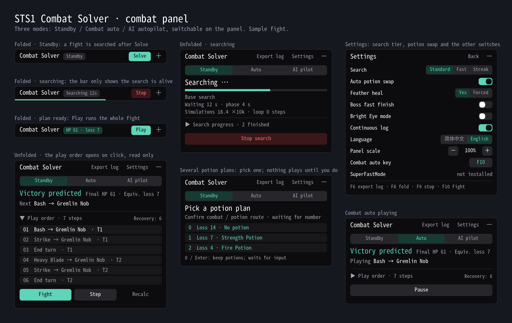

# STS1 Combat Solver

[简体中文](README.zh-CN.md)

A local combat solver for the Ironclad in *Slay the Spire 1*. It searches card and potion lines for the whole fight and can run them step by step, fight every combat automatically, or climb the Spire on full autopilot. If you find it useful, please star the repository.

QQ community group: **232459269**. Share your experience and report issues.

## Install

- [Subscribe on Steam Workshop](https://steamcommunity.com/sharedfiles/filedetails/?id=3814773843) together with ModTheSpire and BaseMod. Choose **Play with Mods**, enable BaseMod and the solver, and start an Ironclad run. Packages are also on [Releases](https://github.com/Yongzhaooo/sts1-combat-solver/releases).
- Windows 10/11 x64 and macOS 11+ on Apple Silicon (M-series) Macs; Intel Macs are not supported. No separate Python is needed. See [Windows installation](WINDOWS_INSTALL.md) and [Mac installation](MACOS_INSTALL.md).
- To build from source, see [BUILDING.md](BUILDING.md).

## Use

- **Three modes, chosen when a run starts and switchable on the panel at any time:** **Standby:** the panel stays folded; press Solve to search this fight and Play to run all of it. When several potion plans are usable the panel opens for you to pick one, and nothing plays until you do. Outside combat you decide. **Combat auto:** every fight runs automatically, including potions, and you make the other decisions. **AI autopilot:** the solver climbs and fights. `F9` returns to Standby at any time.
- **Combat panel:** shows the outcome and the next action; the play order and search progress open on click.
- **Search effort:** set automatically by act and room. On an older PC, switch Settings to **High speed**: every fight uses 1/20 of the search, which is faster but wins less often and loses more HP. For win streaks, switch to **Streak**: acts 1-3 keep the full search, which is slower.
- **Other switches:** in Settings, Auto potion swap (post-combat pickup and swaps; see the [potion policy](POTION_POLICY.zh-CN.md)), Feather heal, Boss fast finish (Settings, off by default: stop searching once a potion-free win costs at most half your HP), sizing, language and Glowing Eye on the Settings page; Feed mode, test mode and route marks in Mods → Config. If the game stutters, lower `searchWorkers` in ModTheSpire's `STS1CombatSolver/config.properties` (default 0, automatic).
- **Keys:**

  | Key | Action |
  | --- | --- |
  | `Enter` | Confirm a typed potion-plan number; automatic modes: resume this fight's automation; nothing in Standby |
  | `F10` (rebindable) | Play or pause this fight, solving it first if needed |
  | `F9` | Stop and return to Standby |
  | `F8` | Fold or unfold the panel |
  | `F7` | Save this act's map with the planned route as a PNG on the desktop |
  | `F6` | Export a diagnostic archive (`Shift+F6` finalizes experience parts when recording is on) |

- **Report a problem:** press `F6` (or **Export log** in the panel header) and send the exported file in the QQ group or GitHub Issues. Data stays on your computer (`%LOCALAPPDATA%\STS1CombatSolver` on Windows, `~/Library/Application Support/STS1CombatSolver` on Mac) and nothing uploads automatically; read [Privacy](PRIVACY.md) before sharing.

## Full autopilot (early)

A small network scores outside decisions (Neow, card rewards, campfires, shops, events, chests and boss relics), reviewed rules choose the map route, and the solver fights. In the training environment it wins 73.1% of 2,442 A20 three-key Heart runs (71.0% of 1,014 runs with the faster v0.9 search). Known weaknesses: it upgrades too rarely, its deckbuilding lacks a plan, and it walks into early elites at full HP. Removal only picks curses, Strikes, Defends and Bash; transforms skip curses, which only become other curses. In events whose outcome a save-and-reload would show (Sensory Stone, The Library, Transmogrifier, Augmenter, Match and Keep, Shining Light, World of Goop, The Mausoleum, Cursed Tome and others), it reads the outcome first and then decides; Neow and the map's ? rooms are never read ahead.

## Let an AI agent play

Send this to your agent (Claude Code, Codex or another agent that can read and write files and run commands on your computer):

> Read https://github.com/Yongzhaooo/sts1-combat-solver/blob/agent-play/AGENT_PLAY.md, follow it to check and configure my Slay the Spire mods (including incompatible mods), then climb the Spire with the solver.

The agent makes the decisions outside combat and the solver fights. Requires v0.9.0 or later.

## Limits

- Ironclad and colorless cards only. Search is finite and does not guarantee optimal play; 七月流火（猫火）'s play shows it still trails top players on some special lines, such as ordering cards for Burning Pact, Snecko Oil, and small loops it sometimes fails to find.
- Mods that change combat rules or RNG are not compatible, for example `SaveStateMod` and Undo (`undothespire`); the solver warns on its Settings page when it detects one.
- Seeded foresight shows events, encounters and transforms beyond what normal play reveals; Glowing Eye (off by default) also covers map rooms ahead, event-fight rewards and what each Neow blessing would give.

## Contributing

Silent, Defect and Watcher solvers are open for collaboration: see the [multi-character scope](docs/multi-character.md) (Chinese), [Contributing](CONTRIBUTING.md) for code and CI requirements, and [Architecture](docs/architecture.md). Before changing a route weight, read the [route-tuning bundle](docs/route-tuning.md) (110 measured A20 Ironclad routes; what it can and cannot answer). Contact: yongzhao.derek@gmail.com.

## Thanks

Special thanks to 七月流火（猫火） for long-term testing and feedback. Playing by hand with the solver, 七月流火（猫火） recently reached a streak of about 80 wins (SL-equivalent) and is close to 100.

Thanks to [gamerpuppy/sts_lightspeed](https://github.com/gamerpuppy/sts_lightspeed) for the C++ combat simulator and search foundation, [destire-mio/sts-ironclad-agent](https://github.com/destire-mio/sts-ironclad-agent) for its modified `combat4r` and Python bindings, and [ForgottenArbiter/CommunicationMod](https://github.com/ForgottenArbiter/CommunicationMod) for the game communication bridge; pinned versions and licenses are in [Third-party notices](THIRD_PARTY_NOTICES.md). [hotwords123/StS2.RandomForeseer](https://github.com/hotwords123/StS2.RandomForeseer) informed the RNG foresight approach, and we studied [Torch1230/CombatSolver](https://github.com/Torch1230/CombatSolver) for its mirror simulation and action verification. These are *Slay the Spire 2* projects; their code is not included here.
