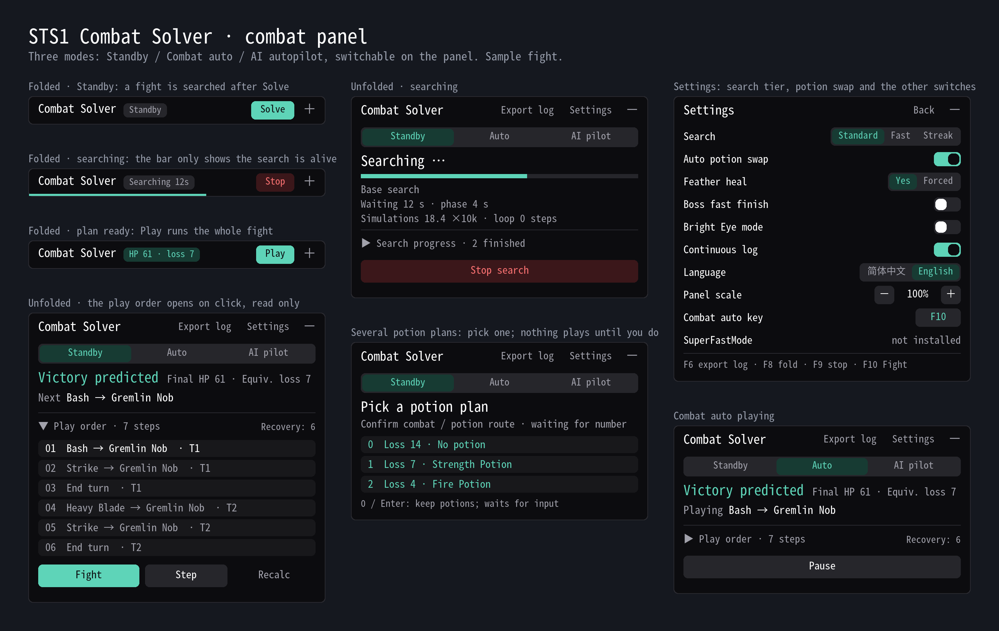

# STS1 Combat Solver — Ironclad & Defect

QQ community group: **232459269**. If you find it useful, please star the repository on [GitHub](https://github.com/Yongzhaooo/sts1-combat-solver).

v1.0.0: New High Focus mode: a Settings switch in Defect runs that makes the solver look for a win ending with 25 or more Focus; the panel shows the predicted Focus next to the HP. Fixed two simulator mismatches that stopped execution mid-fight: Artifact (from Core Surge, say) now blocks Biased Cognition's Focus loss, and Echo Form's copy of Genetic Algorithm carries the block growth the original just added. Sensory Stone shows each colorless group beside its memory option.

v0.9.8: The Defect is now supported in combat: all 75 Defect cards, the 4 orbs and the 9 class relics. Full autopilot outside combat is still Ironclad only. A card-selection screen opened mid-turn (Burning Pact, Seek) is completed with the plan and the card that opened it is finished. Reaper no longer loses its heal on the killing blow; Equilibrium retains the hand at end of turn as the game does; Blood Potion is priced by its heal and not drunk needlessly; Genetic Algorithm's permanent growth counts in the score; pay-HP loops (Bloodletting, Shrug It Off with Body Slam) find lines that block for many turns; potion rows say why a bottle went unused. Thanks to 有事问春风 for building and maintaining the Defect engine, and to 七月流火（猫火） for testing, diagnoses and fixes.

You build the deck and pick the path; it fights the Ironclad and the Defect: one step, one turn or the whole fight. It uses potions, swaps them after combat, and plans relic counters (Happy Flower, Incense Burner, Pen Nib) and Hand of Greed and Feed kills. Search effort follows act and room; Settings offer High speed (1/20 search) and Streak (full search in acts 1-3).

**Full autopilot (early, Ironclad only):** choose Standby, Combat auto or AI autopilot when a run starts; F9 returns to Standby. AI autopilot wins 73.1% of 2,442 A20 three-key Heart runs in training; treat it as a preview.

**Let an AI agent play:** send this to Claude Code, Codex or a similar agent: "Read https://github.com/Yongzhaooo/sts1-combat-solver/blob/agent-play/AGENT_PLAY.md, follow it to check and configure my Slay the Spire mods, then climb the Spire with the solver."

**Install and keys:** subscribe with ModTheSpire and BaseMod and choose Play with Mods. Windows x64 and Apple Silicon Macs. F10 plays or pauses this fight, F9 stops, F8 collapses, F7 saves the map, F6 exports a diagnostic log (local only).
Finite search does not guarantee optimal play. Mods that change combat or RNG, such as SaveStateMod and Undo, are not compatible. Glowing Eye (off by default) reveals hidden RNG.

Silent and Watcher solvers are open for collaboration: see CONTRIBUTING.md on GitHub or write to yongzhao.derek@gmail.com.
