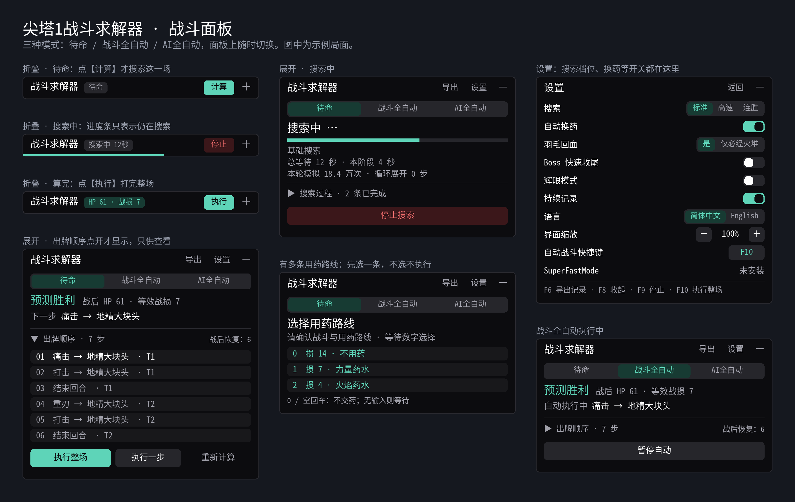

## 战士与机器人战斗求解器

QQ 交流群：**232459269**。觉得有用请到 [GitHub](https://github.com/Yongzhaooo/sts1-combat-solver) 点个 Star。

v0.9.8.2：修复带烟雾弹、开局先弹出选牌界面（如赌博筹码）时战斗全自动无限重算、一张牌都不打的问题。感谢有事问春风的报告和定位。

v0.9.8：正式支持故障机器人的战斗求解，75 张机器人卡牌、4 种充能球和 9 件职业遗物全部实现；局外全自动仍只支持战士。手动出牌途中打开的选牌界面（燃烧契约、搜寻）会按方案选完并打完那张牌。用收割打出最后一击时回血不再丢失；均衡回合末保留手牌与游戏一致；鲜血药水按回复量计价，不再无谓喝掉；基因算法的永久成长计入估值；放血、耸肩无视加全身撞击这类付血循环能找到多回合不掉血的打法；药水分支会说明某瓶药为何没用。感谢有事问春风开发并维护机器人引擎，感谢七月流火（猫火）的测试、诊断和修复。

你负责构筑和选路，它负责战斗：执行一步、本回合或整场。会自动用药、战后换药，并规划小花、香炉、钢笔尖等遗物计数和打钱手、狂宴的击杀时机。搜索量按幕和房间分配，设置里可切高速（1/20 搜索量）或连胜（前三幕不降搜索量）。

**全自动爬塔（早期，仅战士）：**开局选择待命、战斗全自动或 AI全自动，F9 回到待命。AI全自动在训练环境 2,442 局 A20 三钥匙心脏胜率 73.1%，请当试玩功能。

**让 AI agent 来玩：**把这句话发给 Claude Code、Codex 等 agent：“阅读 https://github.com/Yongzhaooo/sts1-combat-solver/blob/agent-play/AGENT_PLAY.md ，按里面的步骤检查并配置我的杀戮尖塔模组，然后用求解器帮我自动爬塔。”

**安装与按键：**订阅本模组、ModTheSpire 和 BaseMod，选择“使用模组启动”。支持 Windows x64 和 Apple Silicon Mac。F10 执行或暂停这场战斗，F9 停止，F8 收起，F7 导出地图，F6 导出诊断日志（仅存本机）。
搜索量有上限，不保证最优。SaveStateMod、Undo 等改动战斗或随机数的模组不兼容。辉眼（默认关闭）会显示隐藏随机信息。

静默猎手和观者的求解器欢迎协作：见 GitHub 上的 CONTRIBUTING.md，或发邮件至 yongzhao.derek@gmail.com。
