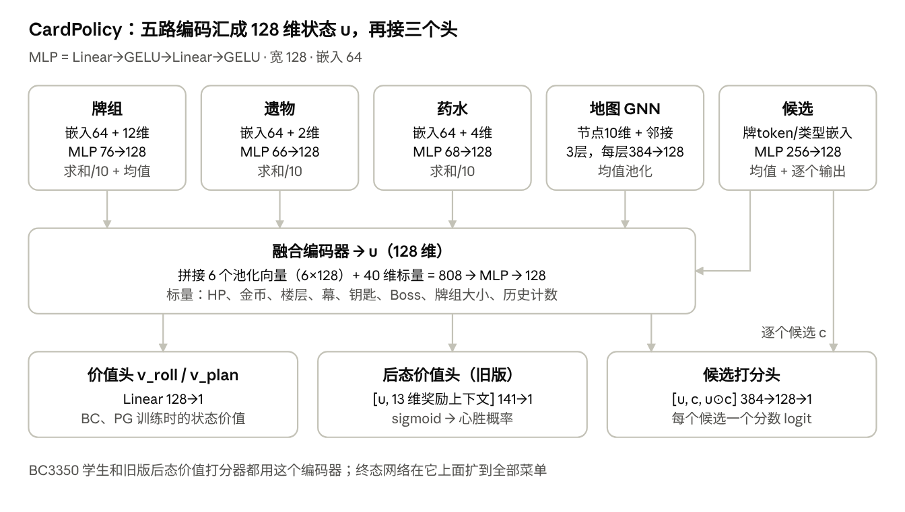

# 尖塔一战士局外规则校对单

2026-10-14 · 规则版本：sts1-combat-solver `f1a1580`

这份文档先说明局外网络方案，再列出战士全自动爬塔中所有由手写规则决定、而非由网络决定的局外选择。请测试人员按游戏常识逐条核对规则内容。

## 网络方案

局外决策由一个网络给当前菜单的所有候选打分，并估计最终的心胜概率。该网络只在整局评估中已被证明带来正收益的菜单上实际接管；其余菜单则由参考局外链负责执行，即 Distill2 模型加上本单所列的手写规则。战斗内决策始终由 C++ 求解器独立负责。

### 两个函数

- `score(o, candidates)`：输入公开状态 o 和当前菜单的全部候选，输出每个候选的分数。
- `value(o)`：输入公开状态，输出拿齐三把钥匙并打赢心脏的概率。

输入只包含玩家看得到的信息。真实种子、内部随机数和未公开的事件与奖励一律不进入输入，唯一例外是营火挖掘的预读（等同一次 SL 即可看到的信息）。

### 实际用到的模型

当前方案用到三个模型。参考链的 Distill2 是单隐层 MLP；本轮 M2 候选不是神经网络，是逻辑回归；真正的深度网络是 CardPolicy（MLP 块加地图图网络），本轮只作对照，它也是终态网络的底座。

| 模型 | 是不是神经网络 | 结构 | 用在哪 |
| --- | --- | --- | --- |
| Distill2（参考链打分器，冻结） | 是，单隐层 MLP | 每个候选拼成一条 11,195 维特征 → Linear 384 → ReLU → Linear 1。特征包括：候选描述 807 维；候选类型与 12 个标量、与幕的交叉项；牌组与公开状态；同屏所有候选的均值和最大值 1,614 维；路线 26 维。由历史强策略的父网络蒸馏而来，Mod 里用纯 Java 推理 | 参考局外链里所有菜单的打分；π\_base 和探索 μ 用的分数 s |
| M2 第一版（本轮候选） | 否，L2 正则逻辑回归 | 后态的词袋特征：牌按（id，升级数）计数，遗物、药水、Boss 指示，再加 23 维（HP、最大 HP、HP 比例、楼层、幕、金币、牌组大小、三把钥匙、13 维奖励上下文）→ w·x + b → Platt 校准 → 心胜概率。正则强度 λ 在 0.1–300 的 8 档里按局分组交叉验证选定 | 只在拿牌页做阈值改选 |
| CardPolicy 编码器（见下图） | 是，MLP 块 + 地图 GNN，宽 128 | 5 路编码汇成 128 维状态 u，再接候选打分头和价值头 | 历史 BC3350 学生；旧版后态价值打分器；M2 线性模型通过信号检验后的对照；终态全菜单网络的底座 |

另有一个旧的拿牌模型 Soft64，现在只作对照：342 维状态（牌组计数、遗物、幕、楼层、进阶、牌组大小、上一层的 HP 和金币）→ Linear 64，加上每张候选牌自己的 64 维向量 → tanh → Linear 1 再加该牌的偏置，在展示的牌之间做 softmax。名字里的 64 就是这层宽度。它是从冻结 teacher 在原生整局数据（6,233 局）上给出的完整候选概率蒸馏来的。它只管拿牌，只有在比“按牌静态偏好选”高出 0.02 时才改选。M1 的 rules\_soft64 对照臂用的就是它加工程规则。



终态网络沿用这个编码器：候选类型从现在的 3 种（牌、跳过、歌唱碗）扩到全部菜单，价值头用整局结果 Z 训练。

### 怎么比较候选

- **选完之后状态确定的选择**：算出每个候选选完之后的状态（后态），用 `value` 比较。包括拿牌、跳过、歌唱碗，敲牌时升级哪张，营火的休息、举重、抽烟、挖掘，商店购买和删牌。
- **结果随机的选择**：用“候选条件价值”Q(o, a) 直接估计。包括地图节点、结果随机的事件选项、变牌和开箱。

### 每个决策怎么定

1. 硬约束：去掉非法动作和棱镜碎片。
2. 菜单属于已释放的域：由网络的改进算子决定，公式见下。
3. 否则：由参考局外链决定，即 Distill2 分数加本单的规则。
4. 参考链也不支持：由训练执行端的兜底规则决定。

参考策略、优势和部署规则（s 是 Distill2 分数，s′ 是后态，a\_base 是参考链的选择）：

```latex
\pi_{\mathrm{ref}}(a \mid o) = \mathrm{softmax}_a\big(s(a)/T\big), \qquad A(o,a) = V(s'_a) - V(s'_{a_{\mathrm{base}}})
```

```latex
a^\ast = \arg\max_a \big[\log \pi_{\mathrm{ref}}(a \mid o) + \beta \, A(o,a)\big]
```

第一版用更保守的形式：只在有数据支持的候选里，校准后的优势超过冻结门槛 τ 才改选，否则照参考链选。

```latex
a^\ast = \arg\max_{a \in E,\ \hat A(o,a) > \tau} \hat A(o,a)\ \text{（没有符合条件的候选时取 } a_{\mathrm{base}}\text{）}
```

### 怎么学

唯一的奖励是整局结果 Z：拿齐三把钥匙并打赢心脏记 1，死亡或缺钥匙记 0。楼层、HP 等都不代替它。

1. **模仿**：学参考策略在各种公开状态下的选择。
2. **学价值**：用整局结果 Z 训练 `value`。
3. **改进**：采集时每局只在一个预先抽好的决策点探索，其余照参考链选。探索点按 μ = softmax(s/T\_μ) 抽样，每个候选概率至少 0.05。有了探索数据，才能知道“如果当时选了另一个”的结果。新策略必须在全新种子上做同种子配对的整局评价，胜出了才会被采用。

### 当前这一轮（M2 第一版）

| 项 | 内容 |
| --- | --- |
| 作用范围 | 只在拿牌页：展示的牌、跳过、歌唱碗 |
| 模型 | L2 正则逻辑回归，输入是后态的“词袋”特征：牌按（id，是否升级）计数、遗物、药水，HP、金币、楼层、幕、钥匙、可见 Boss、牌组大小，加 6 维奖励上下文和 7 维上一层离开时的特征 |
| 为什么先用线性模型 | 历史上线性模型优于 MLP；先确认“有没有可学的信号”，通过后再和 `CardPolicy` 编码器（宽 128）比较 |
| 能改选的候选 | 该牌作为探索选中项出现 ≥ 20 次、作为新牌出现 ≥ 50 次，没有训练中没见过的牌，探索概率 ≥ 0.05 |
| 采集 | 400 局，每局一个探索点。探索点是第 j 个拿牌页，j 在 1–J 里均匀抽；J 和 T\_μ 用 M1 的最终数据冻结，中途值 J=17、T\_μ≈6.07 |
| 验收 | 折外信号检验 → 单点改选价值 → 改选覆盖 ≥ 20% 的局 → 约 250 对同种子整局评价，精确 McNemar 双侧 p < 0.05 |

### 各菜单的分工

- **学习线**（网络依次接手）：拿牌 → 营火（休息、敲牌、举重、抽烟、挖掘）→ 商店购买（含删牌时机）。
- **规则线**（先扩充本单的规则）：Boss 遗物、事件、路线。删哪张牌始终按规则。

本单的规则是参考局外链的一部分，也是网络学习时对比的基线。你们的校对会直接提高这条基线。

## 怎么校对

每条规则一行，请在最后一列“校对意见”写下你的判断：没问题就写“对”；有问题写清楚哪里不对、应该怎么选，最好附上种子、层数或截图。

- **版本**：规则来自 Mod 源码 `sts1-combat-solver` 提交 `f1a1580`。训练用的参考局外链编译自同一份源码，两边逐字节一致。
- **范围**：只列手写规则。拿牌、敲牌时选哪张升级这类选择由网络打分，不在本单里。
- **三种生效方式**：表里每条规则都标了它怎样作用于网络分数。
  - **强制**：规则直接选定，网络分数不起作用。
  - **加分**：在网络分数上加一个值，网络仍可能选别的。
  - **排除**：去掉某些选项，剩下的交给网络选。
- **客户端和训练的差别**：客户端 Mod 会读少数事件的内部随机数，训练时这条路径关闭，只用公开信息，表里会分开写。训练端另有几条兜底规则，只在训练里生效，集中放在最后一节。
- **硬规则**：任何菜单都不拿棱镜碎片（Prismatic Shard），因为四职业卡牌还不支持。这条不需要校对。

## 总览

网络（Distill2）先给每个菜单的全部选项打分，然后先看这个菜单有没有规则。规则覆盖当前场景就按规则改写分数，否则直接取网络最高分。

| 菜单 | 规则的覆盖范围 | 没有规则时 | 见 |
| --- | --- | --- | --- |
| 事件与涅奥 | 有规则的事件按规则处理；按钮数对不上时规则不生效 | 网络选 | 事件与涅奥 |
| 营火 | 只管回忆（红钥匙）的时机 | 休息、敲牌、举重等由网络选 | 营火 |
| 删牌、变牌的牌网格 | 选哪张牌按规则顺序 | 升级网格、篝火精灵献祭由网络选 | 删牌、变牌与篝火精灵 |
| 商店 | 遗物、后期药水在网络分数上加分 | 网络选买什么、何时离开 | 商店 |
| Boss 遗物 | 按手写评分取最高 | — | Boss 遗物与遗物评分 |
| 战斗奖励里的蓝钥匙、宝箱 | 钥匙与遗物的取舍 | 网络选 | 钥匙与宝箱 |
| 地图 | 普通地图一律按路线规划 | Boss 节点等没有下一步时由网络选 | 路线规划 |
| 拿牌（含跳过、歌唱碗） | 没有规则 | 网络选 | — |
| 战斗外用药、弃药 | 只强制喝果汁、有空栏时喝混沌药水 | 其余一律不用、不弃（屏蔽，不交给网络） | 药水领取与药水价值 |

药水领取的价值表见“药水领取与药水价值”。战斗内的出牌、用药和选目标由战斗求解器负责，不在本单里。

## 事件与涅奥

代码给 43 个事件和涅奥写了规则。按钮数只数事件按钮，不计药水动作；没有规则、按钮数对不上、或规则选的位置超出按钮范围时，都交给网络。

| 幕 | 场景 | 规则 | 条件与数值 | 代码 | 校对意见 |
| --- | --- | --- | --- | --- | --- |
| 通用 | 单按钮页（竞技场、篝火精灵、心脏门、结果页等） | 强制（不经网络）：直接点唯一的按钮。 | 页面只有 1 个按钮。 | OutsidePacket:602, :77 |  |
| 通用 | 无规则事件：坠落（Falling）、实验室（Lab）、尼洛斯（N'loth）、给自己的讯息（NoteForYourself）、变化之转盘（Wheel of Change）、对对碰（Match and Keep!）等 | 交给网络。 | 代码里没有这些事件的分支。对对碰的训练侧见“训练执行端的兜底规则”。 | EventRules:261 |  |
| 1 | 大鱼（Big Fish） | 强制：血量够吃甜甜圈，否则吃香蕉；不选盒子（悔恨）。 | 3 个按钮。血量 ≥ 55% 最大生命选第二项甜甜圈，否则第一项香蕉。 | EventRules:162 |  |
| 1 | 牧师（The Cleric） | 强制：只在紧急时治疗；否则有钱有可删牌就净化删牌；否则离开。 | 治疗按钮在金币 ≥ 35 时出现，净化在金币 ≥ 50（进阶 15 以上 75）时出现，按钮数必须和金币对上。治疗：血量 < 15 且已知下一步房间里没有火堆。读不到下一步房间时不治疗。只剩离开一个按钮时按单按钮页直接点过。 | EventRules:110 |  |
| 1 | 冒险者尸体（Dead Adventurer） | 强制。客户端 Mod：预读下一次搜索，安全就继续搜，会遇精英时按血量决定。训练：交给网络。 | 2 个按钮。Mod 读游戏随机数：下次搜索安全选搜索；会遇乐加维林（Lagavulin）离开；会遇地精大块头（Gremlin Nob）且血量 ≥ 75% 搜索；会遇三只哨卫（Sentries）且血量 ≥ 60% 搜索；否则离开。训练（`EventRules.live=false`）读不到预读值，返回空。 | EventRules:134, :276 |  |
| 1 | 金神像（Golden Idol） | 强制：先拿走；触发陷阱后选躲藏（失去最大生命），不逃跑（受伤）、不砸烂。 | 2 个按钮选拿走；3 个按钮选第三项躲藏。“稳赢才砸”没有自动化。 | EventRules:101 |  |
| 1 | 翅膀雕像（Golden Wing） | 强制：有可删牌且血量够就祈祷删牌，否则离开。 | 2 或 3 个按钮。有可删牌且血量 ≥ 40% 选第一项祈祷，否则最后一项离开。不选摧毁。 | EventRules:159 |  |
| 1 | 黏液世界（World of Goop） | 强制：血量够收集金币，否则放手。 | 2 个按钮。血量 ≥ 35% 选收集金币，否则选第二项放手吧（失去金币；代码注释写作“离开”）。 | EventRules:164 |  |
| 1 | 蛇～（Liars Game） | 强制：反对，不拿疑虑诅咒。 | 2 个按钮，选第二项。 | EventRules:169 |  |
| 1 | 活墙壁（Living Wall） | 强制：有可删牌就遗忘（删牌），否则选最后一个功能项。 | 2 或 3 个按钮。有可删牌选第一项遗忘。没有时：3 个按钮选第三项成长（升级）；2 个按钮选第二项。游戏在没有可升级的牌时不列出成长，此时第二项是改变（变化一张牌）。 | EventRules:145 |  |
| 1 | 蘑菇（Mushrooms） | 强制：踩扁（战斗），不吃（寄生）。 | 2 个按钮，选第一项。 | EventRules:166 |  |
| 1 | 破烂软泥（Scrap Ooze） | 强制。客户端 Mod：预读伸手到出遗物共要失多少血，划算才伸手，否则离开。训练：交给网络。 | 2 个按钮。Mod 用游戏随机数副本重放最多 20 次伸手：累计失血 > 0 且 ≤ 25，且当前血量减累计失血 ≥ 10 时伸手，否则离开（20 次内出不了遗物也离开）。训练（`live=false`）读不到预读值，返回空。 | EventRules:130, :287 |  |
| 1 | 闪耀之光（Shining Light） | 强制：走进去后血量仍够才走进去，否则离开。 | 2 个按钮。失血 = 最大生命 × 20%（进阶 15 以上 30%），四舍五入；当前血量减失血 ≥ 55% 最大生命时走进去。 | EventRules:105 |  |
| 2 | 流浪汉的恳求（Addict） | 强制：钱够就给他金币买遗物，否则离开；永不抢夺（羞耻）。 | 金币 ≥ 85 时应有 3 个按钮，选第一项；金币不足时应有 2 个按钮，选第二项离开。 | EventRules:123 |  |
| 2 | 古老文字（Back to Basics） | 强制：有可删牌就简约（删牌），否则质朴（升级所有打击与防御）。 | 2 个按钮。 | EventRules:189 |  |
| 2 | 老乞丐（Beggar） | 强制：钱够且有可删牌就给金币删牌，否则离开。 | 金币 ≥ 75 时应有 2 个按钮。金币不足时只剩 1 个按钮，按单按钮页直接点过。 | EventRules:118 |  |
| 2 | 竞技场（Colosseum） | 强制：打完奴隶贩子后血量够就战斗到底，否则怂了。 | 2 个按钮。血量 ≥ 50% 选第二项战斗到底，否则第一项怂了。前面的单按钮页直接点过。 | EventRules:98 |  |
| 2 | 诅咒书本（Cursed Tome） | 强制：两按钮页一律选第二项，即不读；到最后一页也选停止，不拿书。 | 2 个按钮选第二项。 | EventRules:192 |  |
| 2 | 增益研究者（Drug Dealer） | 强制：永不选 J.A.X.；有齿轮工艺品时喝突变剂，否则当实验对象（变化 2 张）。 | 3 个按钮：有齿轮工艺品（ClockworkSouvenir）选第三项喝一下突变剂，否则第二项当一下实验对象。2 个按钮（游戏没列出变化项）选第二项喝一下突变剂。 | EventRules:141 |  |
| 2 | 被遗忘的祭坛（Forgotten Altar） | 强制：有金神像就献上；否则献祭；献祭会致死时才亵渎（腐朽）。 | 3 个按钮选第一项献上金神像。2 个按钮：献祭失血 = 最大生命 × 25%（进阶 15 以上 35%），四舍五入；当前血量 > 失血才献祭，否则选第二项亵渎。此事件没有离开按钮。 | EventRules:173 |  |
| 2 | 幽灵议会（Ghosts） | 强制：拒绝。人工规则：AI 大牌组打法不适配。 | 2 个按钮，选第二项。 | EventRules:128 |  |
| 2 | 长枪决斗（The Joust） | 强制。客户端 Mod：预读谁赢，押赢家。训练：交给网络，没有公开信息兜底。 | 2 个按钮。Mod 在游戏随机数副本上抽一次 30% 概率：主人赢选第二项主人（赢 250），否则第一项凶手（赢 100）。训练（`live=false`）读不到，返回空。 | EventRules:217, :278 |  |
| 2 | 全知头骨（Knowing Skull） | 强制：付完金币选项的血后仍够且价格不高就拿金币，否则离开；不选药水和牌。 | 4 个按钮（药水、金币、牌、离开），选第二项财富或第四项离开。条件：当前血量 − 金币选项扣血 ≥ 70% 最大生命，且扣血 ≤ 7（即最多拿两次：6、7）。扣血读自金币按钮上显示的数字（公开信息，每拿一次 +1）；客户端 Mod 另从游戏字段读同一个值。读不到时按 6。离开也扣血，数值由游戏给出。【W19b 已修，疑点 14】 | EventRules:100、OutsidePacket:256、:908 |  |
| 2 | 蒙面强盗（Masked Bandits） | 强制：战斗，不付钱。 | 2 个按钮，选第二项。 | EventRules:197 |  |
| 2 | 陵墓（The Mausoleum） | 强制：离开，不开棺材（苦恼）。 | 2 个按钮，选第二项。 | EventRules:171 |  |
| 2 | 巢穴（Nest） | 强制：拿钱就跑，不拿仪式匕首。 | 2 个按钮，选第一项。 | EventRules:187 |  |
| 2 | 大图书馆（The Library） | 强制：血量够读书选牌，否则睡觉回血。 | 2 个按钮。血量 ≥ 40% 选阅读，否则睡觉。 | EventRules:214 |  |
| 2 | 吸血鬼（？）（Vampires） | 强制：拒绝（选最后一项）。 | 2 或 3 个按钮，选最后一项。 | EventRules:195 |  |
| 3 | 心灵绽放（MindBloom） | 强制：我必凯旋（打第一幕 Boss，拿稀有遗物）。 | 3 个按钮，选第一项。 | EventRules:183 |  |
| 3 | 摩艾石像（The Moai Head） | 强制：有金神像就献上换 333 金币；否则血量很低才跳进去回满，不然离开。 | 3 个按钮选第二项献上金神像。2 个按钮：血量 × 3 < 最大生命（不足三分之一）选跳进去，否则第二项离开。 | EventRules:221 |  |
| 3 | 神秘圆球（Mysterious Sphere） | 强制：血量够就打开战斗拿稀有遗物，否则离开。 | 2 个按钮。血量 ≥ 60% 选打开圆球。 | EventRules:225 |  |
| 3 | 秘密传送门（SecretPortal） | 强制：离开。 | 2 个按钮，选第二项。 | EventRules:200 |  |
| 3 | 感知石（SensoryStone） | 强制：血量够拿三张无色牌，否则拿一张。 | 3 个按钮。血量 ≥ 60% 选第三项（3 张），否则第一项（1 张）。两张、三张的扣血由游戏给出。 | EventRules:205 |  |
| 3 | 红面具大人之墓（Tomb of Lord Red Mask） | 强制：有红面具就戴上拿 222 金币；没有就离开，不花光金币买面具。 | 2 个按钮。有红面具选第一项，否则第二项。 | EventRules:202 |  |
| 3 | 蜿蜒走廊（Winding Halls） | 排除：去掉第二项集中精神（苦恼），网络在拥抱疯狂和寻找来路里选。 | 3 个按钮。 | EventRules:259 |  |
| 通用 | 邪恶熔炉（Accursed Blacksmith） | 强制：能锻造就锻造，否则离开；不翻查（疼痛）。 | 3 个按钮选第一项锻造；2 个按钮（游戏没列出锻造）选第二项离开。 | EventRules:180 |  |
| 通用 | “尖端”设计师（Designer） | 强制：先全套服务，其次清洁一下，再其次小修一下；都不行交给网络。 | 价格：小修 40、清洁 60、全套 90（进阶 15 以上 50、75、110）。按金币推算应有的按钮数（清洁、全套、一拳，可能加小修），对不上交给网络。金币 ≥ 全套价且有可删牌选全套；否则金币 ≥ 清洁价且有可删牌选清洁；否则有小修按钮就选小修；否则交给网络。 | EventRules:228 |  |
| 通用 | 复制祭坛（Duplicator） | 强制：祈祷（复制）。 | 2 个按钮，选第一项。 | EventRules:152 |  |
| 通用 | 换脸商（FaceTrader） | 强制。客户端 Mod：预读交易换到的脸，好脸就交易，否则按血量触碰或离开。训练：只按血量触碰或离开。 | 3 个按钮。Mod 重放游戏的随机换脸：换到牧师之脸（FaceOfCleric）或蛇头（SsserpentHead）选第二项交易。其余情况（训练里一律如此）：血量 ≥ 40% 选第一项触碰，否则第三项离开。 | EventRules:208, :277 |  |
| 通用 | 神圣泉水（Fountain of Cleansing） | 强制：喝水（移除诅咒）。 | 2 个按钮，选第一项。代码本身不检查牌组里有没有诅咒。 | EventRules:157 |  |
| 通用 | 金色神龛（Golden Shrine） | 强制：祈祷，不亵渎（悔恨）。 | 3 个按钮，选第一项。 | EventRules:155 |  |
| 通用 | 净化（Purifier） | 强制：有可删牌就祈祷删牌，否则离开。 | 2 个按钮。 | EventRules:148 |  |
| 通用 | 转化神龛（Transmorgrifier） | 强制：有可删牌就祈祷变化，否则离开。 | 2 个按钮。判断用的是可删牌（诅咒、打击、痛击、其他攻击牌）。 | EventRules:150 |  |
| 通用 | 升级神龛（Upgrade Shrine） | 强制：祈祷（升级）。 | 2 个按钮，选第一项。 | EventRules:152 |  |
| 通用 | 蓝衣女子（The Woman in Blue） | 强制：按空药水槽和金币买最多 3 瓶；买不了就离开。 | 4 个按钮。瓶数 = 空槽数（最多 3）；有添水（Sozu）为 0。金币不够就减瓶：1 瓶要 ≥ 20，2 瓶 ≥ 30，3 瓶 ≥ 40。瓶数 > 0 选对应按钮，否则第四项离开。进阶 15 以上离开扣血由游戏给出，不影响决定。 | EventRules:252 |  |
| 涅奥 | 涅奥祝福：掉血删两张（Neow Event） | 加分：给“去除 2 张牌”的选项加 3 分，网络仍可能选别的。 | 奖励为 REMOVE\_TWO，代价为失去最大生命（TEN\_PERCENT\_HP\_LOSS）或受到伤害（PERCENT\_DAMAGE）。有多个时取第一个。命中这一条时不再做下面的诅咒排除。 | EventRules:240, :68 |  |
| 涅奥 | 涅奥祝福：诅咒代价（Neow Event） | 排除：去掉代价为“得到一张诅咒牌”（CURSE）的选项，网络在其余选项里选。 | 没有掉血删两张的选项时生效。没有诅咒代价时交给网络。选项数和按钮数对不上也交给网络。 | EventRules:247 |  |
| 涅奥 | 涅奥对话页（Neow Event） | 强制（不经网络）：直接点唯一的按钮。 | 祝福选项页以外的页面必须只有 1 个按钮，否则报错。 | OutsidePacket:589 |  |

## 营火

营火只有红钥匙一条规则；其余情况由网络在休息、锻造等选项里选。

| 场景 | 规则 | 条件与数值 | 代码 | 校对意见 |
| --- | --- | --- | --- | --- |
| 营火：红钥匙，最后一个或倒数第二个火堆 | 强制：回忆（拿红钥匙）。 | 第三幕，第四幕已开启，还没有红钥匙，页面有回忆（recall）按钮。从当前位置走，经过火堆最少的路线上，后面还剩 ≤ 1 个火堆。 | EventRules:84, OutsidePacket:239 |  |
| 营火：红钥匙，更早的火堆 | 排除：去掉回忆，网络在其余选项（休息、锻造等）里选。 | 同上，但后面还剩 ≥ 2 个火堆。代码不强制锻造。 | EventRules:88 |  |
| 营火：其他情况 | 交给网络。 | 不在第三幕、第四幕未开启、已有红钥匙、没有回忆按钮，或游戏没导出剩余火堆数和第四幕开关时。 | EventRules:86, OutsidePacket:240 |  |
| 营火：选项用完后 | 强制（不经网络）：直接前进。 | 页面没有按钮且可以前进。 | OutsidePacket:700 |  |

## 删牌、变牌与篝火精灵

事件里的删牌、变牌按同一个删牌顺序强制选牌；网格里没有顺序内的牌时交给网络。篝火精灵的献祭不走这个顺序，由网络在全部合法牌里选。

| 场景 | 规则 | 条件与数值 | 代码 | 校对意见 |
| --- | --- | --- | --- | --- |
| 删牌顺序（removalTier） | 强制：从网格里选排序最靠前的牌。 | 0 可删诅咒，1 打击，2 痛击，3 防御，4 其他攻击牌，其余为 9（技能、能力，以及进阶之灾、铃铛的诅咒、死灵诅咒）。同档时取网络分数最高的。只有 9 档的牌时交给网络。已确认的网格和已选中的牌不再参与。【W19b：防御从 9 档移到 3 档，见新发现 4】 | EventRules:54-63、OutsidePacket:411-427 |  |
| 可删牌（事件判断用） | 牧师、老乞丐、活墙壁、翅膀雕像、净化、转化神龛、古老文字、设计师用它判断“有没有牌可删”。 | 牌组里删牌顺序 0 到 4 档的牌数 > 0。防御也算可删牌。 | OutsidePacket:259 |  |
| 事件里的删牌、变牌网格 | 排除：只列出可删诅咒、打击、防御、痛击和其他攻击牌，再按删牌顺序选。 | 删牌（for\_purge）或变牌（for\_transform）网格，不是商店，也不是篝火精灵。网格里一张这类牌都没有时列出全部牌。 | OutsidePacket:833-850 |  |
| 商店删牌网格 | 排除：只列出可删诅咒、打击、防御、痛击，再按删牌顺序选。 | 商店（grid\_from\_shop）不列出其他攻击牌，也不退回全部牌。 | OutsidePacket:833-850、:898 |  |
| 商店删牌按钮 | 排除：牌组里没有可删的牌时不列出删牌服务。要不要买由网络决定。 | 删牌服务可用，金币 ≥ 价格，且牌组里有可删诅咒、打击、防御或痛击。进阶之灾、铃铛的诅咒、死灵诅咒不算（与游戏 CardGroup.getPurgeableCards 一致）。【W19b 已修，疑点 6】 | OutsidePacket:809、:887-902 |  |
| 篝火精灵（Bonfire Elementals）：献祭 | 网络决定：网格列出游戏给的全部合法牌，由网络打分选，不套删牌顺序，不按血量分支。只保留合法性和硬规则（游戏本身不列出不可移除的诅咒）。 | 事件类为 Bonfire 时。事件里的单按钮页直接点过。客户端与训练（参考链在真值 JVM 里跑同一个 OutsidePacket）都由网络打分。【W19b：取代原第 3 档排除稀有牌与低血蓝卡分支，见疑点 17、新发现 5】 | OutsidePacket:411-413、:840、:904 |  |

## 商店

商店规则只调整遗物和后期药水的网络分，买不起的商品和满栏时的药水不进入候选，删牌顺序由删牌规则强制。

| 场景 | 规则 | 条件与数值 | 代码 | 校对意见 |
| --- | --- | --- | --- | --- |
| 候选范围 | 排除 | 只列出价格 ≤ 当前金币的卡牌、遗物、药水。买不起的商品不是候选。 | OutsidePacket:730、:746、:760 |  |
| 药水能否购买 | 排除 | 没有添水（Sozu）且至少有一个空药水栏时，药水才是候选。满栏时不会为买药先弃药。 | OutsidePacket:740-753 |  |
| 遗物加分 | 加分 | 每个买得起的遗物：网络分加 (遗物评分 − 5) × 0.6。例如 9 分加 2.4，5 分加 0，3 分减 1.2。评分见下一节的遗物评分表，网络仍可选别的商品。 | OutsidePacket:342-346 |  |
| 棱镜碎片（PrismaticShard） | 加分（大幅减分） | 评分 −100，网络分加 (−100 − 5) × 0.6 = −63。在 Mod 里这只是极大的减分；训练执行端另有硬拒绝，提交前直接拦下。 | OutsidePacket:345、RelicScore:56、:60 |  |
| 药水加分 | 加分 | 只有药水价值 > 0 时，网络分加 lateBonus × 0.1。lateBonus 只在第 3 幕 43 层及以后或第 4 幕 55 层及以前不为 0，例如能力药水（PowerPotion）加 2.4。药水基础价值不参与商店。 | OutsidePacket:332-340、PotionRewards:28-45 |  |
| 规则不介入 | 网络决定 | 没有买得起的遗物，且没有获得后期加成的药水时，商店完全由网络决定。卡牌、删牌、离开三类选项从不加分。 | OutsidePacket:348 |  |
| 删牌按钮可用 | 排除 | 同时满足：删牌服务可用；删牌价格 ≤ 当前金币；牌组中有可删诅咒、打击、防御或痛击。不可移除的诅咒不算。 | OutsidePacket:809、:887-902 |  |
| 删牌网格候选 | 排除 | 商店删牌网格只列可删诅咒、打击、防御、痛击，其他牌不可选。 | OutsidePacket:833-850、:894-902 |  |
| 删牌网格顺序 | 强制 | 可移除诅咒优先，然后是打击、痛击、防御，同档内选网络分高的。 | OutsidePacket:411-427、EventRules:54-63 |  |

## Boss 遗物与遗物评分

Boss 遗物按手写评分强制选最高分，只有全部低于 2 分时才强制跳过；跳过后回到已开的 Boss 宝箱就离开，不再打开。同一张评分表也用于商店加分和蓝钥匙比较。

| 场景 | 规则 | 条件与数值 | 代码 | 校对意见 |
| --- | --- | --- | --- | --- |
| Boss 遗物打分 | 强制 | 空鸟笼（Empty Cage）和符文立方体（Runic Cube）按当前牌组算分，其他查表，表中没有的记 5。 | OutsidePacket:260、RelicScore:79-96 |  |
| 选择 | 强制 | 选分数最高的 Boss 遗物；同分时选网络分高的。 | OutsidePacket:261-271 |  |
| 跳过 | 强制 | 最高分 < 2 且界面有跳过按钮时强制跳过。只有三个选项都是 1 分（添水、破碎金冠、灵体外质）时才会发生。没有跳过按钮时交给网络决定。 | OutsidePacket:307-315 |  |
| 跳过后回到 Boss 宝箱 | 强制 | 宝箱类型为 BossChest 且已打开（chest_open）时选“离开宝箱”，不再打开。训练真值在跳过后把宝箱导出为未打开，这条看不到；由参考链记住本层已跳过，只要真值给出 Proceed 就离开，不再开箱。【W19b，新发现 1】 | OutsidePacket:332-339、reference\_chain.py:118-121、:195-200 |  |
| 跳过后没有前进路径 | 强制 | 宿主在跳过后找不到 Proceed（旧真值构建跳过后只给“开箱”）时，再回到 Boss 遗物界面就不跳过，改拿评分最高的遗物（同分取网络分高的）。训练里由参考链记住本层已跳过，并以 boss\_skip\_exhausted 请求 OutsidePacket.bossSkipLeadsOn=false；客户端不会遇到。Boss 遗物里没有棱镜碎片，训练端仍有棱镜硬拒绝。【W19b，新发现 1】 | OutsidePacket:20、:307-311、ReferenceChain.java:25-27、reference\_chain.py:152-157、:205-207 |  |
| 常量 NEUTRAL | 数值 | 5。表中没有的遗物记 5，商店加分以 5 为零点。 | RelicScore:12 |  |
| 常量 SAPPHIRE\_KEY | 数值 | 6。蓝钥匙的估值，用于与关联遗物比较。 | RelicScore:14 |  |
| 常量 SKIP\_BELOW | 数值 | 2。Boss 遗物最高分低于此值时跳过。 | RelicScore:16 |  |

| 遗物 | 评分 | 随牌组调整 | 代码 | 校对意见 |
| --- | --- | --- | --- | --- |
| 潘多拉的魔盒（Pandora's Box） | 10 | 无 | RelicScore:27 |  |
| 符文圆顶（Runic Dome） | 9 | 无 | RelicScore:28 |  |
| 符文金字塔（Runic Pyramid） | 9 | 无 | RelicScore:28 |  |
| 星盘（Astrolabe） | 9 | 无 | RelicScore:28 |  |
| 空鸟笼（Empty Cage） | 8 | 仅 Boss 选择时随牌组：可移除诅咒与打击/防御/痛击合计 ≥ 2 张记 8，1 张记 6，0 张记 2。进阶之灾、铃铛的诅咒、死灵诅咒不计。 | RelicScore:29 |  |
| 异蛇之眼（Snecko Eye） | 7 | 无 | RelicScore:30 |  |
| 咖啡滤杯（Coffee Dripper） | 7 | 无 | RelicScore:30 |  |
| 召唤铃铛（Calling Bell） | 6 | 无 | RelicScore:31 |  |
| 黑星（Black Star） | 6 | 无 | RelicScore:31 |  |
| 神圣树皮（SacredBark） | 5 | 无 | RelicScore:32 |  |
| 诅咒钥匙（Cursed Key） | 5 | 无 | RelicScore:32 |  |
| 贤者之石（Philosopher's Stone） | 5 | 无 | RelicScore:32 |  |
| 小屋子（Tiny House） | 4 | 无 | RelicScore:33 |  |
| 奴隶贩子颈环（SlaversCollar） | 4 | 无 | RelicScore:33 |  |
| 融合之锤（Fusion Hammer） | 4 | 无 | RelicScore:33 |  |
| 黑暗之血（Black Blood） | 3 | 无 | RelicScore:34 |  |
| 天鹅绒颈圈（Velvet Choker） | 3 | 无 | RelicScore:34 |  |
| 符文立方体（Runic Cube） | 3 | 仅 Boss 选择时随牌组：牌组含放血、祭品、御血术、残暴、自燃、疼痛任一张记 8，否则 3。 | RelicScore:34 |  |
| 痛楚印记（Mark of Pain） | 2 | 无 | RelicScore:35 |  |
| 添水（Sozu） | 1 | 无 | RelicScore:36 |  |
| 破碎金冠（Busted Crown） | 1 | 无 | RelicScore:36 |  |
| 灵体外质（Ectoplasm） | 1 | 无 | RelicScore:36 |  |
| 蜥蜴尾巴（Lizard Tail） | 9 | 无 | RelicScore:38 |  |
| 钨合金棍（TungstenRod） | 9 | 无 | RelicScore:38 |  |
| 枯木树枝（Dead Branch） | 9 | 无 | RelicScore:38 |  |
| 钢笔尖（Pen Nib） | 9 | 无 | RelicScore:38 |  |
| 壶铃（Girya） | 9 | 无 | RelicScore:38 |  |
| 鸟居（Torii） | 8 | 无 | RelicScore:39 |  |
| 外卡钳（Calipers） | 8 | 无 | RelicScore:39 |  |
| 生姜（Ginger） | 8 | 无 | RelicScore:39 |  |
| 萝卜（Turnip） | 8 | 无 | RelicScore:39 |  |
| 芒果（Mango） | 8 | 无 | RelicScore:39 |  |
| 宁静烟斗（Peace Pipe） | 8 | 无 | RelicScore:39 |  |
| 带骨肉（Meat on the Bone） | 8 | 无 | RelicScore:39 |  |
| 奥利哈钢（Orichalcum） | 8 | 无 | RelicScore:39 |  |
| 赌博筹码（Gambling Chip） | 8 | 无 | RelicScore:39 |  |
| 卡戎之灰（Charon's Ashes） | 8 | 无 | RelicScore:40 |  |
| 手里剑（Shuriken） | 8 | 无 | RelicScore:40 |  |
| 硫磺（Brimstone） | 8 | 无 | RelicScore:40 |  |
| 螺类化石（FossilizedHelix） | 8 | 无 | RelicScore:40 |  |
| 针线（Thread and Needle） | 8 | 无 | RelicScore:40 |  |
| 金刚杵（Vajra） | 7 | 无 | RelicScore:41 |  |
| 锚（Anchor） | 7 | 无 | RelicScore:41 |  |
| 灯笼（Lantern） | 7 | 无 | RelicScore:41 |  |
| 百年积木（Centennial Puzzle） | 7 | 无 | RelicScore:41 |  |
| 铜制鳞片（Bronze Scales） | 7 | 无 | RelicScore:41 |  |
| 红头骨（Red Skull） | 7 | 无 | RelicScore:41 |  |
| 纸蛙（Paper Frog） | 7 | 无 | RelicScore:41 |  |
| 缩放仪（Pantograph） | 7 | 无 | RelicScore:41 |  |
| 颂钵（Singing Bowl） | 7 | 无 | RelicScore:42 |  |
| 问号牌（Question Card） | 7 | 无 | RelicScore:42 |  |
| 熔火之蛋（Molten Egg 2） | 7 | 无 | RelicScore:42 |  |
| 自成型黏土（Self Forming Clay） | 7 | 无 | RelicScore:42 |  |
| 转经轮（Prayer Wheel） | 7 | 无 | RelicScore:42 |  |
| 香炉（Incense Burner） | 7 | 无 | RelicScore:42 |  |
| 舵盘（CaptainsWheel） | 7 | 无 | RelicScore:42 |  |
| 打击木偶（StrikeDummy） | 7 | 表值 7 在现行路径中不使用。商店和蓝钥匙比较按牌组中打击类牌张数：0 张记 0，1 张记 3，2 张记 5，≥ 3 张记 7。计入各色打击、剑柄打击、双重打击、狂野打击、完美打击、迅捷打击。 | RelicScore:43 |  |
| 弹珠袋（Bag of Marbles） | 7 | 无 | RelicScore:43 |  |
| 古茶具套装（Ancient Tea Set） | 7 | 无 | RelicScore:43 |  |
| 不休陀螺（Unceasing Top） | 4 | 无。只在 4 分一组里写一次。【W19b 已修，疑点 3】 | RelicScore:52 |  |
| 草莓（Strawberry） | 6 | 无 | RelicScore:44 |  |
| 赤牛（Akabeko） | 6 | 无。【W19b 新增，新发现 3】 | RelicScore:47 |  |
| 梨子（Pear） | 6 | 无 | RelicScore:44 |  |
| 双节棍（Nunchaku） | 6 | 无 | RelicScore:44 |  |
| 意外光滑的石头（Oddly Smooth Stone） | 6 | 无 | RelicScore:44 |  |
| 套娃（Matryoshka） | 6 | 无 | RelicScore:44 |  |
| 白兽雕像（White Beast Statue） | 6 | 无 | RelicScore:44 |  |
| 永恒羽毛（Eternal Feather） | 6 | 无 | RelicScore:44 |  |
| 魔法花（Magic Flower） | 6 | 无 | RelicScore:45 |  |
| 瓶装旋风（Bottled Tornado） | 6 | 无 | RelicScore:45 |  |
| 瓶装火焰（Bottled Flame） | 6 | 无 | RelicScore:45 |  |
| 瓶装闪电（Bottled Lightning） | 6 | 无 | RelicScore:45 |  |
| 水银沙漏（Mercury Hourglass） | 6 | 无 | RelicScore:45 |  |
| 船夹板（HornCleat） | 6 | 无 | RelicScore:45 |  |
| 地精之角（Gremlin Horn） | 6 | 无 | RelicScore:46 |  |
| 捕梦网（Dream Catcher） | 6 | 无 | RelicScore:46 |  |
| 皇家枕头（Regal Pillow） | 6 | 无 | RelicScore:46 |  |
| 铲子（Shovel） | 6 | 无 | RelicScore:46 |  |
| 古钱币（Old Coin） | 6 | 无 | RelicScore:46 |  |
| 冰淇淋（Ice Cream） | 6 | 无 | RelicScore:46 |  |
| 历石（StoneCalendar） | 6 | 无 | RelicScore:46 |  |
| 橙色药丸（OrangePellets） | 6 | 无 | RelicScore:46 |  |
| 齿轮工艺品（ClockworkSouvenir） | 6 | 无 | RelicScore:47 |  |
| 鸟面瓮（Bird Faced Urn） | 6 | 无 | RelicScore:47 |  |
| 李家华夫饼（Lee's Waffle） | 6 | 无 | RelicScore:47 |  |
| 玩具扑翼飞机（Toy Ornithopter） | 6 | 无 | RelicScore:47 |  |
| 小血瓶（Blood Vial） | 5 | 无 | RelicScore:48 |  |
| 准备背包（Bag of Preparation） | 5 | 无 | RelicScore:48 |  |
| 开心小花（Happy Flower） | 5 | 无 | RelicScore:48 |  |
| 磨刀石（Whetstone） | 5 | 无 | RelicScore:48 |  |
| 战纹涂料（War Paint） | 5 | 无 | RelicScore:48 |  |
| 开信刀（Letter Opener） | 5 | 无 | RelicScore:48 |  |
| 墨水瓶（InkBottle） | 5 | 无 | RelicScore:48 |  |
| 星系仪（Orrery） | 5 | 无 | RelicScore:49 |  |
| 会员卡（Membership Card） | 5 | 无 | RelicScore:49 |  |
| 大锅（Cauldron） | 5 | 无 | RelicScore:49 |  |
| 昆虫标本（PreservedInsect） | 5 | 无 | RelicScore:49 |  |
| 发条靴（Boot） | 5 | 无 | RelicScore:49 |  |
| 毒巫娃娃（Du-Vu Doll） | 5 | 无 | RelicScore:49 |  |
| 干瘪之手（Mummified Hand） | 5 | 无 | RelicScore:49 |  |
| 冻结之蛋（Frozen Egg 2） | 5 | 无 | RelicScore:50 |  |
| 毒素之蛋（Toxic Egg 2） | 5 | 无 | RelicScore:50 |  |
| 精致折扇（Ornamental Fan） | 5 | 无 | RelicScore:50 |  |
| 日晷（Sundial） | 5 | 无 | RelicScore:50 |  |
| 冠军腰带（Champion Belt） | 5 | 无 | RelicScore:50 |  |
| 御守（Omamori） | 4 | 无 | RelicScore:51 |  |
| 佛珠手链（Juzu Bracelet） | 4 | 无 | RelicScore:51 |  |
| 巨口储蓄罐（MawBank） | 4 | 无 | RelicScore:51 |  |
| 微笑面具（Smiling Mask） | 4 | 无 | RelicScore:51 |  |
| 送货员（The Courier） | 4 | 无 | RelicScore:51 |  |
| 化学物X（Chemical X） | 4 | 无 | RelicScore:51 |  |
| 工具箱（Toolbox） | 4 | 无 | RelicScore:51 |  |
| 多利之镜（DollysMirror） | 4 | 无 | RelicScore:51 |  |
| 苦无（Kunai） | 4 | 无 | RelicScore:52 |  |
| 怀表（Pocketwatch） | 4 | 无 | RelicScore:52 |  |
| 蓝蜡烛（Blue Candle） | 4 | 无 | RelicScore:52 |  |
| 孙子兵法（Art of War） | 4 | 无 | RelicScore:52 |  |
| 药水腰带（Potion Belt） | 3 | 无 | RelicScore:53 |  |
| 羽翼之靴（WingedGreaves） | 3 | 无 | RelicScore:53 |  |
| 餐券（MealTicket） | 3 | 无 | RelicScore:53 |  |
| 陶瓷小鱼（CeramicFish） | 3 | 无 | RelicScore:53 |  |
| 黑石护符（Darkstone Periapt） | 3 | 无 | RelicScore:53 |  |
| 医药箱（Medical Kit） | 3 | 无 | RelicScore:53 |  |
| 冻结之眼（Frozen Eye） | 3 | 无 | RelicScore:53 |  |
| 手钻（HandDrill） | 3 | 无 | RelicScore:54 |  |
| 奇怪的勺子（Strange Spoon） | 3 | 无 | RelicScore:54 |  |
| 勇气投石索（Sling） | 3 | 无 | RelicScore:54 |  |
| 算盘（TheAbacus） | 3 | 无 | RelicScore:54 |  |
| 小宝箱（Tiny Chest） | 3 | 无 | RelicScore:54 |  |
| 扭曲漏斗（TwistedFunnel） | 2 | 无 | RelicScore:55 |  |
| 精灵便便（Spirit Poop） | 2 | 无 | RelicScore:55 |  |
| 共生病毒（Symbiotic Virus） | 2 | 无 | RelicScore:55 |  |
| 泪滴吊坠盒（TeardropLocket） | 2 | 无 | RelicScore:55 |  |
| 棱镜碎片（PrismaticShard） | −100 | 无。score() 另有硬编码，直接返回 −100。 | RelicScore:56 |  |
| 其他未列出的遗物 | 5 | 无 | RelicScore:62 |  |

## 钥匙与宝箱

第一、二幕的宝箱一律拿遗物；最终幕开启后，第三幕的蓝钥匙与关联遗物比分：遗物 ≤ 5 分就拿钥匙；第三幕最后一个宝箱无条件拿钥匙。红钥匙和绿钥匙由营火规则和路线规划规则处理。

| 场景 | 规则 | 条件与数值 | 代码 | 校对意见 |
| --- | --- | --- | --- | --- |
| 规则前提 | 网络决定 | 游戏状态缺少最终幕开关字段，或奖励里没有蓝钥匙，或找不到关联遗物选项时，规则不介入。 | OutsidePacket:296、:309、:318 |  |
| 蓝钥匙对关联遗物 | 强制 | 第一、二幕：一律拿遗物（后面每幕第 8 行都还有宝箱）。第三幕：最终幕开启且 6 > 关联遗物评分时拿钥匙，否则拿遗物。也就是遗物 ≤ 5 分（包括未列出的遗物）拿钥匙，≥ 6 分拿遗物。评分用带牌组的版本，打击木偶按牌组计。【W19b 已修，疑点 4】 | OutsidePacket:372-376 |  |
| 最终幕未开启 | 强制 | 强制拿关联遗物。 | OutsidePacket:319 |  |
| 第三幕最后宝箱：奖励 | 强制 | 同时满足：第 3 幕；最终幕开启；还没有蓝钥匙；当前节点是宝箱；从当前位置可达的更高行没有宝箱。此时无论遗物几分都拿钥匙。未知房间不当作后面的宝箱。 | OutsidePacket:275-285、:310-311 |  |
| 第三幕最后宝箱：开箱 | 强制 | 条件同上时强制开箱。 | OutsidePacket:287-291 |  |
| 普通宝箱开或离开 | 网络决定 | 不满足上一行条件时，开箱和离开都是候选，由网络决定。 | OutsidePacket:673-683 |  |
| 奖励界面顺序 | 排除 | 奖励里有遗物、蓝钥匙或绿钥匙时，只列这些选项。金币、药水、卡牌等在它们处理完后再列。 | OutsidePacket:630-645 |  |
| 绿钥匙奖励 | 网络决定 | 绿钥匙是普通候选，与遗物同列，没有专门规则。 | OutsidePacket:637-639 |  |
| 红钥匙：火堆 | 强制 / 排除 | 见“营火”一节。 | OutsidePacket:239-246、EventRules:84-89 |  |
| 路线与钥匙 | 强制 / 加分 | 第 3 幕、最终幕开启、缺绿钥匙或红钥匙时，路线先比缺几把钥匙，再比路线分。经过燃烧精英算拿到绿钥匙，经过火堆算拿到红钥匙。路线分 = 路线评分 − 10000 × 缺失钥匙数。第一、二幕只有对燃烧精英的软加分，见“路线规划”。 | OutsidePacket:162-176、RoutePlanner:51-58、:125 |  |

## 药水领取与药水价值

战斗奖励药水按手写价值自动领取或换药：有空栏就领价值最高的一瓶；满栏时换药收益必须大于 2 才会弃旧换新。

| 场景 | 规则 | 条件与数值 | 代码 | 校对意见 |
| --- | --- | --- | --- | --- |
| 触发 | 强制 | 战斗奖励界面，不在战斗阶段，且奖励里有药水。有添水（Sozu）时不领。 | PotionRewards:19-22、:132-138、SolverMod:1294-1297 |  |
| 自动开关 | 强制 | 自动换药默认开。关闭时只在屏幕上显示建议，不执行。 | SolverMod:224、:1299、:1328 |  |
| 先处理遗物和钥匙 | 排除 | 奖励里还有遗物、蓝钥匙或绿钥匙时，先不动药水。 | SolverMod:1288-1292 |  |
| 有空栏 | 强制 | 只看第一个空栏，收益记为 100 + max(0, 价值)，所以一定会领。有多瓶药水时先领价值最高的一瓶，领完重新评估。价值未知（−1）的药水也会领。 | PotionRewards:141-145、:158、:163 |  |
| 满栏换药 | 强制 | 逐个尝试替换可丢弃、且价值 ≥ 0 的旧药水。收益 = 换后库存值 − 换前库存值，必须 > 2，取收益最大的方案。不可丢弃或价值未知的旧药水不会被换掉。 | PotionRewards:146-171 |  |
| 满栏且新药水未知 | 排除 | 新药水价值为 −1 时不换，提示“未知药水：请手动比较”。 | PotionRewards:154 |  |
| 库存值 | 数值 | 库存值 = 组合分 + 各药水 max(0, 价值) 之和。 | PotionRewards:127-131 |  |
| 组合分 | 数值 | 牌组没有“上限”组合，且库存里同时有抽牌药（迅捷药水、赌徒特酿）和选项药（能力、技能、攻击、无色、混沌药水，异蛇之油、邪教徒药水、力量药水）时加 12，否则 0。 | PotionRewards:115-126 |  |
| “上限”组合 | 数值 | 满足任一即算有上限：有恶魔形态或观察弱点；突破极限加燃烧或金刚杵；壁垒、巩固、全身撞击三张齐；腐化加黑暗之拥或枯木树枝；灼热攻击升级 ≥ 4 次。 | PotionRewards:101-114 |  |
| 药水价值 | 数值 | 基础价值 ≤ 0 时原样返回，不加后期加成；否则价值 = 基础价值 + lateBonus。 | PotionRewards:23-27 |  |
| 后期加成窗口 | 数值 | 第 3 幕 43 层及以后，或第 4 幕 55 层及以前，lateBonus 才不为 0，数值见下表。 | PotionRewards:28-45 |  |
| 执行与校验 | 强制 | 换药时先丢弃旧药水，再领取奖励。领取期间库存变化、离开奖励界面或 5 秒内没确认，就停止自动。 | SolverMod:1301-1322、:1271、:1276-1285、PotionRewards:188-199 |  |
| 果汁（Fruit Juice） | 强制 | 自动换药开启时，非奖励界面，或奖励界面已无遗物和钥匙时，自动使用果汁。网络打分侧（客户端与训练）也把喝果汁强制为最高分。 | SolverMod:1252-1263、:1272、:1293、OutsidePacket:183-213 |  |
| 网络侧药水选项 | 排除 / 强制 | 有空栏、没有添水、奖励里没有遗物和钥匙时，网络候选里有药水奖励（换药规则不变）。战斗外的用药、弃药：只强制两种用药——能用果汁时立刻喝；有混沌药水且还有至少 1 个空栏时喝。其余用药、弃药一律屏蔽（网络首选是它们时改取下一个非药水选项）。鲜血药水留到战斗。游戏战斗外只允许用果汁、鲜血药水、混沌药水（烟雾弹要求在战斗中，仙女药水不能主动用），M1 日志里出现过的战斗外用药也只有这三种。训练参考链同样只执行 OutsidePacket 选中的那一个“potion use”。【W19b 已修，疑点 12】 | OutsidePacket:183-213、:866-880、reference\_chain.py:181-186 |  |

| 药水 | 基础价值 | 随牌组或局面调整 | 后期加成 lateBonus | 代码 | 校对意见 |
| --- | --- | --- | --- | --- | --- |
| 火焰药水（Fire Potion） | 20 | 第 2 幕起记 14 | 0 | PotionRewards:57 |  |
| 爆炸药水（Explosive Potion） | 18 | 无 | 0 | PotionRewards:58 |  |
| 格挡药水（Block Potion） | 16 | 无 | 0 | PotionRewards:59 |  |
| 类固醇药水（SteroidPotion） | 5 × hits | 牌组有恶魔之焰、旋风斩、连续拳、飞剑回旋镖任一时 hits = 5，记 25；否则 hits = 2，记 10 | 0 | PotionRewards:47-51、:60 |  |
| 速度药水（SpeedPotion） | 12 | 有橙色药丸时记 28 | 0 | PotionRewards:61 |  |
| 力量药水（Strength Potion） | 18 + 2 × hits | hits 同类固醇药水：记 28 或 22 | 0 | PotionRewards:62 |  |
| 敏捷药水（Dexterity Potion） | 24 | 无 | 0 | PotionRewards:63 |  |
| 能量药水（Energy Potion） | 20 | 无 | 8 | PotionRewards:42、:64 |  |
| 迅捷药水（Swift Potion） | 34 | 无 | 18 | PotionRewards:36、:65 |  |
| 赌徒特酿（GamblersBrew） | 34 | 无 | 18 | PotionRewards:36、:66、:120 |  |
| 精炼混沌（DistilledChaos） | 36 | 无 | 18 | PotionRewards:36、:67 |  |
| 恐惧药水（FearPotion） | 24 | 无 | 0 | PotionRewards:68 |  |
| 虚弱药水（Weak Potion） | 22 | 无 | 14 | PotionRewards:41、:69 |  |
| 先古药水（Ancient Potion） | 12 | 第 2 幕记 26 | 16 | PotionRewards:38、:70 |  |
| 攻击药水（AttackPotion） | 19 | 无 | 0 | PotionRewards:71 |  |
| 技能药水（SkillPotion） | 23 | 无 | 0 | PotionRewards:72 |  |
| 能力药水（PowerPotion） | 28 | 无 | 24 | PotionRewards:37、:73 |  |
| 无色药水（ColorlessPotion） | 23 | 无 | 0 | PotionRewards:74 |  |
| 复制药水（DuplicationPotion） | 32 | 牌组有恶魔之焰、燔祭、岿然不动、恶魔形态、突破极限任一时记 40 | 12 | PotionRewards:40、:52、:75 |  |
| 液态记忆（LiquidMemories） | 30 | 无 | 16 | PotionRewards:38、:76 |  |
| 流动铜液（LiquidBronze） | 16 | 无 | 0 | PotionRewards:77 |  |
| 钢之精华（EssenceOfSteel） | 12 | 无 | 0 | PotionRewards:78 |  |
| 再生药水（Regen Potion） | 28 | 有绽放印记时记 0 | 0 | PotionRewards:79 |  |
| 鲜血药水（BloodPotion） | 32 | 有绽放印记时记 0 | 0 | PotionRewards:80 |  |
| 果汁（Fruit Juice） | 60 | 自动换药开启时会在战斗外直接喝掉 | 0 | PotionRewards:81 |  |
| 瓶中精灵（FairyPotion） | 70 | 有绽放印记时记 0，后期加成也不加 | 20 | PotionRewards:35、:82 |  |
| 邪教徒药水（CultistPotion） | 34 | 无 | 18 | PotionRewards:39、:83 |  |
| 混沌药水（EntropicBrew） | 40 | 无 | 0 | PotionRewards:84 |  |
| 异蛇之油（SneckoOil） | 22 | 无 | 0 | PotionRewards:85 |  |
| 罐装幽灵（GhostInAJar） | 60 | 无 | 20 | PotionRewards:35、:86 |  |
| 铁之心（HeartOfIron） | 36 | 无 | 14 | PotionRewards:41、:87 |  |
| 万灵药水（ElixirPotion） | 18 | 无 | 0 | PotionRewards:88 |  |
| 烟雾弹（SmokeBomb） | 12 | 无 | 0 | PotionRewards:89 |  |
| 熔炉的祝福（BlessingOfTheForge） | 9 | 无 | 0 | PotionRewards:90 |  |
| 其他未列出的药水 | −1（未知） | 有空栏时照样领取；满栏时不换入；在库存里时不会被换掉 | 0 | PotionRewards:91 |  |

## 路线规划

路线规划负责普通地图上的每一个分支抉择。游戏每次处在地图界面、且网络首选动作属于地图节点时，规划器就会运行。它依据当前公开信息（当前幕、当前行、连线拓扑、血量、金币、未升级攻防能力牌数、已有遗物与钥匙持有情况），从当前所有合法可选的下一格出发，深度优先遍历所有能走到第 14 行（Boss 门前最后一层）的完整路径。

规划器评估路线遵循两大原则：第一是**钥匙第一**，第三幕必须优先保证进第四幕的心脏门票（绿钥匙与红钥匙），缺钥匙更少的路线绝对胜出；第二是**加权打分**，在缺钥匙数相同时，按当前幕的均衡权重档（`balanced`）综合评估路线里的精英战、营火、问号、普通怪与商店，并结合血量健康度与金币购买力做出奖惩，最终挑出全局最优路线并走出第一步。

### 运行时机

规划器只在普通地图的常规选路阶段介入，其他场景一律不运行或直接跳过。

术语解释：
- `balanced` 档：路线配置的均衡权重档位。文件虽预留了 upgrade（强化偏好）与 removal（删牌偏好）两档，但代码固定只读取各幕的 balanced 档。

| 项 | 规则 | 条件与数值 | 代码 | 校对意见 |
| --- | --- | --- | --- | --- |
| 权重档 | 每幕固定用“幕:balanced”一档权重 | 表里的 upgrade、removal 两档不会被读到 | RoutePlanner:37 |  |
| 不出规划 | 以下情况不给路线 | 找不到权重档；下一行越界；地图上已能直接进 Boss | RoutePlanner:54、:57 |  |

### 起点与枚举

规划器把当前可选的下一步作为起点，向前看完整幕直到第 14 行。Boss 房间固定在第 15 行，不需要纳入路线枚举。

| 项 | 规则 | 条件与数值 | 代码 | 校对意见 |
| --- | --- | --- | --- | --- |
| 起点 | 从可选的下一格出发 | 地图界面用可选节点；第 0 行取所有有出边的格子；其他情况取当前格子的子节点 | RoutePlanner:58-63 |  |
| 飞行起点（翅膀靴 WingedGreaves） | 只能靠飞行到达、不是当前节点出边的起点，路线分减 0.5 | 当前节点在下一行有出边时才扣；所以飞行起点要比最好的出边起点高出 0.5 以上才会被选，同分或差距更小时走出边，不花次数。没有任何出边时照旧可飞。M1 有 16 次飞行里 8 次是在与出边同分时按最左列飞的（如种子 5534104192084612327 第 471 步）。【W19b】 | RoutePlanner:16-19、:74-75、:85-86 |  |
| 枚举 | 每个起点枚举到第 14 行的所有路径，只留最好的一条 | 终点是第 14 行，Boss 格不计入 | RoutePlanner:67-80 |  |

### 比较顺序：先缺钥匙、再看分数

路线两两比较时，先看谁缺的钥匙少；缺钥匙数相同，再看谁的路线加权得分高。

术语解释：
- `缺钥匙数`（`missingKeys`）：路线走完后仍然缺失的关键钥匙数量，只在第 3 幕且最终幕开启时统计。如果玩家还没拿到绿钥匙，且路线上没有经过燃烧精英，记缺 1 把；如果还没拿到红钥匙，且路线上没有经过营火，记缺 1 把。第一、二幕的燃烧精英只有软加分，不计缺钥匙。

| 项 | 规则 | 条件与数值 | 代码 | 校对意见 |
| --- | --- | --- | --- | --- |
| 比较 | 先比缺钥匙数，少的赢；相同再比分数，高的赢 | 缺钥匙更少的路径绝对优先；相同则得分高于对方 1e-9 获胜 | RoutePlanner:28-31 |  |
| 钥匙需求 | 只在第 3 幕且最终幕开启时检查 | 没有绿钥匙时要经过燃烧精英；没有红钥匙时要经过休息处。最终幕未开启时不要求（游戏也不放燃烧精英）。【W19b 已修，疑点 7】 | RoutePlanner:51-52 |  |
| 缺钥匙计数 | 路径没满足一项需求就记 1 | 燃烧精英只认第一个；缺钥匙数为 0、1 或 2 | RoutePlanner:53、:71-73 |  |
| 第一、二幕燃烧精英 | 软加分：经过燃烧精英的路线额外加一次本幕 elite 权重（燃烧精英按两个精英算） | 同时满足：第 1 或 2 幕；最终幕开启；还没有绿钥匙；当前 HP ≥ 70% 最大 HP；第 2 幕，或第 1 幕本幕已打过精英。低血打精英惩罚照常算；不计缺钥匙。拿到绿钥匙后第三幕的要求自然满足。【W19b，新发现 2 按用户决定改做】 | RoutePlanner:53-58、:105、:125 |  |

### 各打分项

每条路线的综合得分为各项特征与其权重的乘积之和。

术语与要素解释：
- `prepare`（精英前备战）：遭遇本路线第一个精英之前经历的普通怪物战斗数量。用于鼓励在挑战精英前先打小怪积累卡牌奖励，上限受当前幕已打战斗数压制。
- `pre_fire`（精英前休息）：在第 0 行规划整幕路线时，若第一个精英前设有营火，可提供升级或回血保障，因此额外记一次奖励。
- `early_shop`（早商店）与 `late_shop`（晚商店）：能够买得起东西的商店根据出现行号获得的加权倾斜。早商店偏好较小行号，晚商店偏好较大行号。
- `close_shops`（商店过近）：路线中相邻两个买得起的商店相隔 ≤ 3 行的次数。金币来不及积累就连续进店会浪费节点收益，属于惩罚项。
- `low_hp_elites`（低血打精英惩罚）：生命值低于 50% 时去打精英的惩罚项。血量越低、该路线精英越多，扣分越重。
- `fire`（有效营火数）：考虑是否持有融合之锤（能否锻造）、咖啡滤杯（能否休息）、牌组待升级牌数与是否满血。第 3 幕缺红钥匙时，还必须扣减 1 个火堆留给回忆。
- `shop`（商店）：沿途模拟金币。每打一场普通战斗加 15、精英加 30 的预期金币（其他房间 0），进店时金币满 150 按 150 扣除，否则尝试按一次删牌费扣除，扣得起才算买得起。

| 项 | 规则 | 条件与数值 | 代码 | 校对意见 |
| --- | --- | --- | --- | --- |
| 精英 elite | 每个精英计 1 | × 权重 elite | RoutePlanner:96、:114 |  |
| 休息处 fire | 能用上的休息处数量 | 可用数 = 休息处数（缺红钥匙时减 1）。有效数取两者较大：没有融合之锤时为 min(可用数, 待升级数)；没有咖啡滤杯且未满血时为 min(可用数, 1)。× 权重 fire | RoutePlanner:106-108 |  |
| 待升级数 | 用于休息处一项 | 数牌组里未升级的攻击/技能/能力牌，灼热攻击不论是否升级都算 | RoutePlanner:43-49 |  |
| 问号 event | 每个问号计 1 | × 权重 event | RoutePlanner:98 |  |
| 普通战斗 monster | 每个普通敌人计 1 | × 权重 monster | RoutePlanner:99 |  |
| 精英前备战 prepare | 第一个精英前的普通战斗数 | 路径无精英或本幕已打过精英时为 0；上限 = max(0, 第 1 幕 3 / 其他幕 2 − 本幕已见战斗数)。× 权重 prepare | RoutePlanner:99、:110-112 |  |
| 精英前休息 pre\_fire | 第一个精英前有休息处记 1 | 只在第 0 行规划且路径有精英时计入。× 权重 pre\_fire | RoutePlanner:97、:113 |  |
| 商店 shop | 按路径模拟金币，买得起的商店计 1 | 沿途普通战斗 +15、精英 +30。进店时金币 ≥ 150 则花 150，否则花一次删牌费。买得起就扣钱。× 权重 shop。【W19b 已修，疑点 9】 | RoutePlanner:103-114 |  |
| 删牌费 | 用于商店一项 | 有微笑面具为 50；否则为基础价 × 0.5（会员卡）或 × 0.8（送货员）或 × 1，四舍五入；基础价默认 75 | RoutePlanner:92-93 |  |
| 早商店 early\_shop | 每个买得起的商店加 (14 − 行号) / 14 | × 权重 early\_shop | RoutePlanner:103 |  |
| 晚商店 late\_shop | 每个买得起的商店加 行号 / 14 | × 权重 late\_shop | RoutePlanner:103 |  |
| 商店过近 close\_shops | 与上一个买得起的商店相隔 ≤ 3 行记 1 | 只在本店和上一家都买得起时计 | RoutePlanner:110-111 |  |
| 低血打精英 low\_hp\_elites | 精英数 × max(0, 1 − 2 × 当前 HP / 最大 HP) | HP 在一半以上时为 0。× 权重 low\_hp\_elites | RoutePlanner:117 |  |

### 地图覆盖与回退网络

规划器计算完毕后，结果会直接覆盖 Mod 给地图选项赋予的网络分数。遇到下表列出的情况时，直接使用网络原来的打分。

| 项 | 规则 | 条件与数值 | 代码 | 校对意见 |
| --- | --- | --- | --- | --- |
| 地图覆盖 | 地图界面用规划结果替代网络打分 | 每个格子选项得分 = 该起点最佳路线分 − 10000 × 缺钥匙数；没有路线的选项为负无穷 | OutsidePacket:156-169 |  |
| 回退网络 | 以下情况直接用网络分数 | 不是地图界面；网络首选不是地图格子；没有任何路线（如 Boss 前）；最佳路线的起点不在选项里 | OutsidePacket:156、:159、:169 |  |

### 路线权重表与算分示例

以下是路线规划器加载的权重表（`route-preferences.json`，版本 `preference-v4`）。代码只读取各幕的 `balanced` 档：

| 档 | elite | fire | event | monster | prepare | pre\_fire | shop | early\_shop | late\_shop | close\_shops | low\_hp\_elites |
| --- | --- | --- | --- | --- | --- | --- | --- | --- | --- | --- | --- |
| 1:balanced | 4.0 | 2.0 | 0.25 | -0.25 | 1.0 | 2.0 | 1.0 | 0.0 | 1.0 | -2.0 | -6.0 |
| 1:upgrade（未用） | 4.0 | 4.0 | 0.25 | -0.25 | 1.0 | 2.0 | 1.0 | 0.0 | 1.0 | -2.0 | -6.0 |
| 1:removal（未用） | 4.0 | 0.5 | 1.75 | -0.25 | 1.0 | 2.0 | 2.5 | 0.0 | 1.0 | -2.0 | -6.0 |
| 2:balanced | 1.380691 | 2.619309 | 1.211382 | 0.538618 | 0.5 | 0.0 | 1.0 | 2.074187 | -0.074187 | -2.0 | -6.0 |
| 2:upgrade（未用） | 2.0 | 4.0 | 2.25 | -0.5 | 0.5 | 0.0 | 1.0 | 2.0 | 0.0 | -2.0 | -6.0 |
| 2:removal（未用） | 2.0 | 0.5 | 3.75 | -0.5 | 0.5 | 0.0 | 2.5 | 2.0 | 0.0 | -2.0 | -6.0 |
| 3:balanced | 3.0 | 2.0 | 0.5 | -0.25 | 0.0 | 0.0 | 1.0 | 0.0 | 0.0 | -2.0 | -6.0 |
| 3:upgrade（未用） | 3.0 | 4.0 | 0.5 | -0.25 | 0.0 | 0.0 | 1.0 | 0.0 | 0.0 | -2.0 | -6.0 |
| 3:removal（未用） | 3.0 | 0.5 | 2.0 | -0.25 | 0.0 | 0.0 | 2.5 | 0.0 | 0.0 | -2.0 | -6.0 |

#### 算分示例（第 1 幕开局第 0 行）

假设在第 1 幕开局（第 0 行），战士生命值 80/80（满血），金币 200，牌组是初始牌组（10 张未升级的攻击/技能牌），无融合之锤或咖啡滤杯。某候选路线由当前行延伸至第 14 行，节点统计如下：
- 精英战（`elite`）：共 2 场。对应权重 4.0，得分为 `2 × 4.0 = 8.0`。
- 营火休息处（`fire`）：共 3 处。第 1 幕不需要扣减红钥匙，`available = 3`；可以锻造且待升级牌数 10 ≥ 3，因此有效营火数 `fires = 3`。对应权重 2.0，得分为 `3 × 2.0 = 6.0`。
- 问号事件（`event`）：共 4 个。对应权重 0.25，得分为 `4 × 0.25 = 1.0`。
- 普通怪物战斗（`monster`）：共 4 场。对应权重 -0.25，得分为 `4 × (-0.25) = -1.0`。
- 精英前备战（`prepare`）：第一个精英前有 2 场普通战斗，未达第 1 幕上限 3，`prepare = 2`。对应权重 1.0，得分为 `2 × 1.0 = 2.0`。
- 精英前营火（`pre_fire`）：在第 0 行规划且第一个精英前经过了 1 处营火，`pre_fire = 1`。对应权重 2.0，得分为 `1 × 2.0 = 2.0`。
- 商店（`shop`）：在第 7 行有一处商店。进店时金币 200 ≥ 150，可以负担并扣除 150 金币，记为 1 家有效商店。对应权重 1.0，得分为 `1 × 1.0 = 1.0`。
- 早/晚商店（`early_shop` / `late_shop`）：该店位于第 7 行，`early = (14 - 7)/14 = 0.5`，`late = 7/14 = 0.5`。第 1 幕权重中 early_shop 为 0.0，late_shop 为 1.0，得分合计为 `0.0 × 0.5 + 1.0 × 0.5 = 0.5`。
- 商店过近惩罚（`close_shops`）：仅有 1 家商店，无过近情况，得分为 0.0。
- 低血打精英惩罚（`low_hp_elites`）：当前血量 100% ≥ 50%，惩罚系数为 0，得分为 0.0。
- 缺钥匙扣分：第 1 幕不统计钥匙，`missingKeys = 0`，扣分为 0。

该路线最终总得分计算为：
`8.0 (elite) + 6.0 (fire) + 1.0 (event) - 1.0 (monster) + 2.0 (prepare) + 2.0 (pre_fire) + 1.0 (shop) + 0.5 (shops_timing) = 19.5`。
该分数即作为该起点路线参与横向比选的最终路线分。

## 训练执行端的兜底规则

以下规则只在训练用的 Java 真值环境里、参考链拒绝作答时运行，客户端 Mod 里从不运行。【唯一规则】表示参考链在该场景固定不作答，这条就是实际做法；【参考链通常覆盖】表示实际很少触发。

| 场景 | 规则 | 何时生效 | 代码 | 校对意见 |
| --- | --- | --- | --- | --- |
| 参考链拒绝条件 | 参考链返回空，交给下面的规则 | 链调用出错；事件是对对碰（Match and Keep!）；界面类型不在映射表里；没有可执行的合法选项；商店删牌子调用出错、没有可删的牌或那张牌不合法 | reference\_chain.py:147-154、:183-199 |  |
| 棱镜碎片（Prismatic Shard） | 任何菜单都不能获得。先从合法动作里屏蔽；若所有合法动作都会获得它则报错停止；提交动作前再检查一次 | 【唯一规则】每一步都生效，参考链的选项也受它约束 | outside\_rules.py:45-69、drive.py:393-395、:848 |  |
| 对对碰（Match and Keep!） | 走通用事件规则：取第一个选项按钮；没有选项按钮时取第一个带牌的合法动作，再没有就取第一个合法动作 | 【唯一规则】参考链固定拒绝此事件。W19b 未改：按记忆配对需要翻开的牌面，真值的公开观测只给“Face-down card”，翻开后也不导出牌面，要先由真值导出翻开的牌（W18／真值负责） | reference\_chain.py:18、drive.py:409-410、:465-473 |  |
| 未映射界面 | 按当前阶段走下面对应的规则；没有对应规则时取第一个选项 | 【唯一规则】界面类型不在映射表时 | reference\_chain.py:20-22、drive.py:474 |  |
| 战斗外药水 | 参考链：只执行 OutsidePacket 强制的那一个用药（果汁；有空栏时的混沌药水），其余药水选项保留打分但不执行。Driver 自己的兜底规则仍不用药 | 每个战斗外界面 | reference\_chain.py:181-186、drive.py:408 |  |
| 涅奥（Neow） | 按顺序找第一个含关键词且不带红字代价的选项：Remove、Max HP、Choose、Transform、gold；都没有取第一个 | 【参考链通常覆盖】 | drive.py:411-415 |  |
| 战斗奖励 | 有钥匙先拿钥匙（已有蓝钥匙时不拿）；再拿第一个普通奖励，药水栏满时跳过药水；再打开未打开过的卡牌奖励；最后离开 | 【参考链通常覆盖】 | drive.py:418-434 |  |
| 选卡 | 在固定优先表 PICKS 里选排名最高、牌组里少于 2 张的牌；牌组 < 22 张或排名在前 12 才拿，否则跳过 | 【参考链通常覆盖】 | drive.py:40-45、:435-445 |  |
| Boss 遗物 | 选第一个不在回避表里的遗物；全在回避表时选一个环境支持的遗物；再不行跳过 | 【参考链通常覆盖】参考链在跳过后回到 Boss 宝箱时先选 Proceed，没有 Proceed 时再回到遗物界面改拿最高分遗物（见“Boss 遗物与遗物评分”）回避表：灵体外质、召唤铃铛、符文圆顶、天鹅绒颈圈、贤者之石、痛楚印记、添水、小屋子、潘多拉的魔盒、星盘、空鸟笼、黑星、破碎金冠 | drive.py:46-49、:457-464 |  |
| 事件 | 第一个选项写明“Lose N HP”且 N ≥ 当前 HP，并且有 [Leave] 时选离开；否则取第一个选项 | 【参考链通常覆盖】 | drive.py:465-473 |  |
| 宝箱、继续 | 取第一个选项 | 【参考链通常覆盖】 | drive.py:474 |  |
| 休息处 | 第 3 幕没有红钥匙且（HP ≥ 50% 或楼层 ≥ 46）时回忆；HP < 60% 休息；否则按锻造、举重、休息的顺序选。之后可被攻略规则改写：HP < 40% 或 Boss 前 HP < 75% 休息，满血或有咖啡滤杯/绽放印记时不休息 | 【参考链通常覆盖】 | drive.py:446-456、outside\_rules.py:194-237 |  |
| 升级选牌 | 优先祭品、腐化、坚毅、上勾拳、痛击、武装，再按 PICKS 顺序；打击、防御排最后 | 【参考链通常覆盖】 | drive.py:476-494、outside\_rules.py:239-262 |  |
| 商店 | 先删打击再删防御（要付得起）；再买 PICKS 前 16 名里的牌；否则离开。攻略打分比基线高出 2 分时改买；买不起、已有的遗物、满栏药水等不能买 | 【参考链通常覆盖】 | drive.py:589-601、outside\_rules.py:264-349 |  |
| 地图 | 每格估值递归累加；低血去休息处；精英准备度不够时避开精英；第 3 幕只保留能在同一条可见路线上拿齐缺失钥匙的选项 | 【参考链通常覆盖】 | drive.py:603-619、outside\_rules.py:408-467 |  |

## 提取时发现的疑点

下面是对照代码时发现的可疑之处。W19b（2026-10-14）已按用户决定修了其中一部分，状态见“代码核查结果”后的“W19b 修复状态”。

| # | 疑点 | 影响 | 代码 | 校对意见 |
| --- | --- | --- | --- | --- |
| 1 | 赌徒特酿的 id 写成 "Gambler's Brew"，游戏 id 是 "GamblersBrew" | 它的基础价值 34、后期加成 18 和抽牌组合 +12 都不生效，按未知药水处理 | PotionRewards:36、:66 |  |
| 2 | 熔炉的祝福没有价值 | 有空栏会领，满栏时永远不换入，拿到后也永远不换出 | PotionRewards:90 |  |
| 3 | 不休陀螺在评分表里写了两次（7 和 4） | 实际按 4 分 | RelicScore:43、:52 |  |
| 4 | 蓝钥匙规则不分幕 | 第一幕的宝箱也可能拿钥匙而放弃 ≤ 5 分的遗物；未列出的遗物一律算 5 分 | OutsidePacket:319-321 |  |
| 5 | 空鸟笼几乎总是 8 分 | 初始打击、防御、痛击都算垃圾牌，战士牌组通常至少有 2 张 | RelicScore:29 |  |
| 6 | 商店删牌按钮把不可移除的诅咒也算进去 | 牌组里只有进阶之灾、铃铛的诅咒、死灵诅咒时，按钮会出现，但网格里没有可选的牌 | OutsidePacket:855-859 |  |
| 7 | 路线规划的绿钥匙需求不看最终幕开关 | 第四幕未开启时，第三幕仍会去打燃烧精英；营火的红钥匙规则是看了开关的 | RoutePlanner:51 |  |
| 8 | 路线规划只用 balanced 一档权重 | upgrade、removal 两档从没被读到 | RoutePlanner:37 |  |
| 9 | 路线模拟里金币只减不增 | 后面的商店被低估；“商店过近”也算上买不起的商店 | RoutePlanner:100-103 |  |
| 10 | 第三幕只认第一个燃烧精英 | 地图上有多个燃烧精英时，其余的不算拿到绿钥匙 | RoutePlanner:53 |  |
| 11 | 普通宝箱可能不开 | 开不开由网络决定，只有第三幕最后一个宝箱强制打开 | OutsidePacket:673-683 |  |
| 12 | 客户端 Mod 里网络可以在任何战斗外界面用药或弃药，没有规则约束；训练里则战斗外完全不用药 | 两边行为不一致 | OutsidePacket:823-837、reference\_chain.py:179-182 |  |
| 13 | 长枪决斗在训练里没有公开信息兜底 | 交给网络选 | EventRules:217 |  |
| 14 | 全知头骨在训练里价格固定按 6 算 | 血量够就一直拿金币，没有次数上限 | EventRules:94、:274 |  |
| 15 | 神圣泉水不检查有没有诅咒 | 两个按钮就喝 | EventRules:157 |  |
| 16 | 活墙壁只有 2 个按钮时选第二项，那是“改变” | 没有可删牌也没有可升级牌时会变化一张牌 | EventRules:145 |  |
| 17 | 篝火精灵可能献上稀有攻击牌 | 稀有攻击牌在删牌顺序第 3 档 | OutsidePacket:372 |  |
| 18 | 红钥匙之前的火堆只排除回忆 | 休息还是锻造由网络选，旧版规则单写的是“照常敲牌” | EventRules:88 |  |
| 19 | 对对碰在训练里取第一个选项 | 等于总是翻第一张牌 | drive.py:465-473 |  |

旧版事件规则单（v0.4.2，2026-10-09）里的一些事件名和诅咒名与官方简中不同，本单已按游戏自带的简中文本统一。

### 代码核查结果

19 条疑点逐条对照了反编译游戏源码和 M1 参考链的 97 局 A20 日志。规则单对代码的描述全部准确。其中 6 条确认是错误、5 条打法有问题、8 条不是问题。下表供测试人员参考，最终结论仍以你们的校对意见为准。修改状态见下面的“W19b 修复状态”；规则一改，参考基线就要换版本（新的参考链构建身份）。

| # | 结论 | 实际影响 | 建议 |
| --- | --- | --- | --- |
| 1 | 确认是错误 | 游戏 id 是 GamblersBrew，赌徒特酿被当作未知药水：空栏照领，满栏不换入，在库里也不会被换出 | 三处 id 改为 GamblersBrew |
| 2 | 确认是错误 | 熔炉的祝福是原版普通药水。它占住栏位就不会被换出；M1 有 30 局库里出现过它 | 补一个低价值（约 8–10） |
| 3 | 确认是错误 | 不休陀螺实际按 4 分（后写入的覆盖前面的 7 分）。M1 战斗奖励里出现 7 次 | 删掉一处，4–5 分合理 |
| 4 | 打法有问题 | 每幕第 8 行都有宝箱，第一、二幕也会拿蓝钥匙。M1 第一幕拿钥匙 48 次、第二幕 16 次，约三分之二的局提前放弃了一个 ≤ 5 分的遗物 | 第一、二幕一律拿遗物，只在第三幕比分 |
| 5 | 不是问题 | 初始牌组有 10 张垃圾牌，空鸟笼本来就该 8 分 | 保持（可考虑不把痛击算垃圾牌） |
| 6 | 确认是错误 | A20 必带进阶之灾。初始牌删光后删牌按钮仍会出现，参考链报 purge\_no\_card。M1 有 3 局共 4 次 | 删牌按钮的诅咒计数排除不可移除的诅咒 |
| 7 | 确认是错误（训练里无影响） | 第四幕关闭时游戏不放燃烧精英；红钥匙需求仍会逼路线经过火堆。训练第四幕始终开启 | 绿、红钥匙需求都加上第四幕开关 |
| 8 | 不是问题 | 另两档是从没用过的配置 | 保持 |
| 9 | 打法有问题 | 金币少时后面的商店被记成买不起；两家买不起但相隔 ≤ 3 行的店也照样扣分 | 沿路按房间加预期金币；“商店过近”只计买得起的店 |
| 10 | 不是问题 | 每张地图最多一个燃烧精英 | 保持 |
| 11 | 不是问题 | M1 的 289 个普通宝箱网络全部选择开箱 | 保持 |
| 12 | 打法有问题 | M1 中 Distill2 有 372 次首选战斗外用药（果汁 267、鲜血药水 92、混沌药水 13）。训练屏蔽了，客户端会真的执行 | 两边统一；混沌药水可单写规则 |
| 13 | 不是问题 | 押凶手期望 +20，押主人 +25，只差 5 金币 | 保持，或固定押凶手 |
| 14 | 确认是错误 | 全知头骨每拿一次涨 1 点血。训练只看血量，M1 有一局连拿 4 次（6+7+8+9 血） | 读按钮上的价格（公开信息） |
| 15 | 不是问题 | 只有身上有可移除诅咒时事件才会出现 | 保持 |
| 16 | 不是问题 | 条件实际碰不到；M1 活墙壁全部选遗忘 | 保持 |
| 17 | 打法有问题 | 只在没有诅咒、打击、痛击时才会烧到第 3 档，此时稀有攻击排在防御前面被献出。频率低 | 第 3 档排除稀有牌 |
| 18 | 不是问题 | M1 共 16 次：敲牌 13、休息 3 | 保持 |
| 19 | 打法有问题 | 每次都翻编号最小的两张，基本等于放弃事件；M1 有 8 局遇到 | 低优先级：按记忆配对 |

核查中另外发现五处规则单没列的问题：

1. **跳过 Boss 遗物会死循环（最严重）**：三个遗物都低于 2 分时规则选择跳过，但训练环境跳过后会回到 Boss 宝箱，参考链又打开它。M1 种子 6074962807151633384（第 17 层，灵体外质、破碎金冠、添水）因此循环了 29,901 次，最后以 DECISION\_CAP 结束。建议：没有前进路径时不跳过，改拿最高分的遗物。
2. **第一、二幕的燃烧精英不计**：每幕都会放燃烧精英，直到拿到绿钥匙为止；路线规划只在第三幕要求它。要不要提前拿是策略问题。
3. **未列出的遗物**：战士能从宝箱拿到、却不在评分表里的只有赤牛（普通遗物），它按 5 分算，会让位给蓝钥匙。
4. **防御永远不算可删牌**：打击、痛击和诅咒删光后，净化、翅膀雕像、活墙壁这类事件要么删一张真正的攻击牌，要么不删就离开。
5. **篝火精灵低血分支只看攻击牌**：同样能回满血的罕见技能和能力牌从来不是候选。

### W19b 修复状态（2026-10-14）

| # | 状态 | 现在的做法 |
| --- | --- | --- |
| 1 | 已修 | 三处 id 改为 GamblersBrew，基础价值 34、后期加成 18、抽牌组合生效。 |
| 2 | 已修 | 熔炉的祝福基础价值 9，无后期加成。 |
| 3 | 已修 | 删掉 7 分那处，保持 4 分（行为不变）。 |
| 4 | 已修 | 第一、二幕一律拿遗物；只在第三幕比分，第三幕最后宝箱仍强制拿钥匙。 |
| 6 | 已修 | 删牌按钮只算可移除诅咒，与 CardGroup.getPurgeableCards 一致。 |
| 7 | 已修 | 绿、红钥匙需求都要求最终幕开启。 |
| 9 | 已修 | 沿路普通战斗 +15、精英 +30；“商店过近”只计买得起的店。30 条参考开局里 6 条路线、15 个分数随之改变，夹具改为 Java 现值。 |
| 12 | 已修 | 客户端与训练统一：战斗外只强制喝果汁、有空栏时喝混沌药水，其余用药弃药屏蔽，鲜血药水留到战斗。 |
| 14 | 已修 | 读金币按钮上的扣血；70% 门槛按付血后的血量算。 |
| 17 | 改为网络决定 | 篝火精灵献祭不再按删牌顺序或血量分支，由网络在全部合法牌里打分（用户决定，避免拆掉关键组合牌）。 |
| 19 | 未修 | 训练真值的公开观测不导出翻开的牌面，按记忆配对无从实现；需要真值先导出（W18／真值负责）。 |
| 5、8、10、11、13、15、16、18 | 保持 | 不是问题。 |
| 新发现 1 | 已修 | 跳过后回到 Boss 宝箱：有 Proceed 就离开，不再开箱；没有前进路径（旧真值）时再回到遗物界面改拿最高分遗物。真值侧跳过后补 Proceed 由 W18 负责。 |
| 新发现 2 | 已做（软加分） | 第一、二幕强势时（HP ≥ 70%，第 2 幕或第 1 幕已打过精英）经过燃烧精英加一次 elite 权重，不计缺钥匙。 |
| 新发现 3 | 已修 | 赤牛 6 分。 |
| 新发现 4 | 已修 | 防御排在可删诅咒、打击、痛击之后、其他牌之前，并计入可删牌。 |
| 新发现 5 | 改为网络决定 | 同 #17。 |
| W20 翅膀靴 | 已修 | 飞行起点要比最好的出边起点高出 0.5 以上才飞；同分走出边。真值不再提供不连通的格子由 W20 负责。 |
